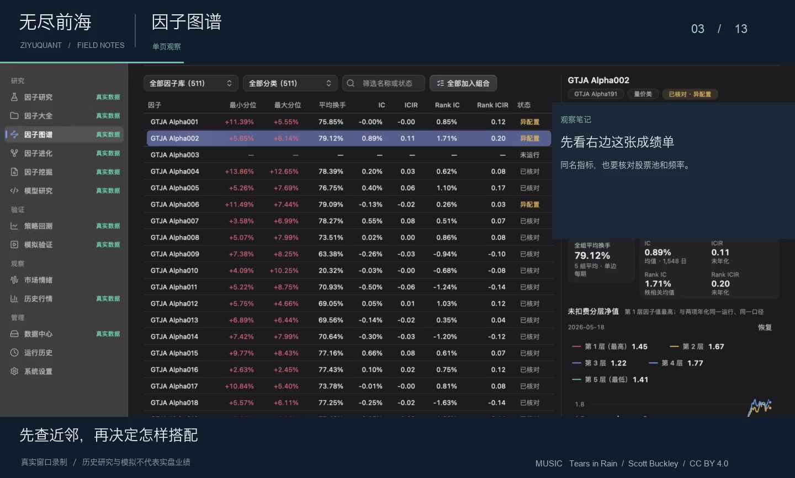
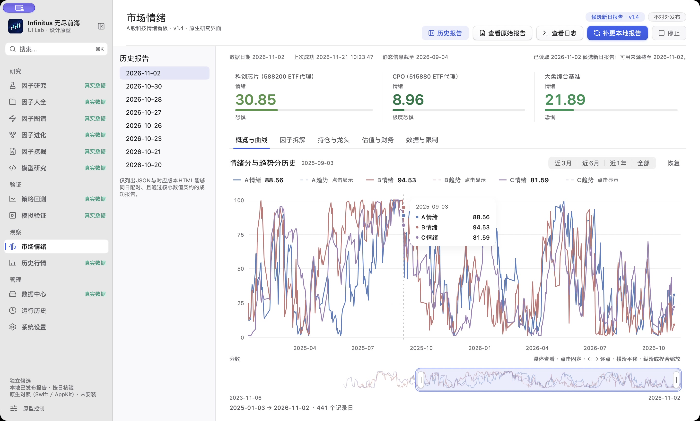
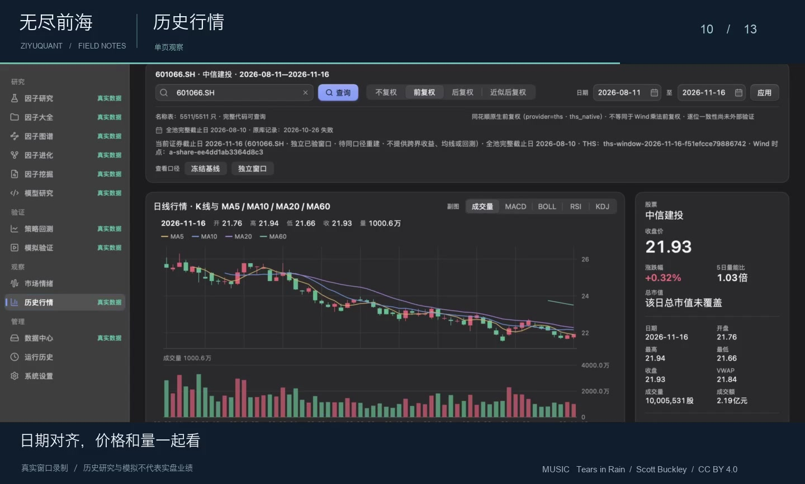

# 无尽前海 · ZiyuQuant

这是我用来看 A 股、读研报和试因子的工作台。我想回答的问题都挺具体：一个指标过去有用吗？两个好看的因子，买的是不是同一批股票？回测说该买，那天真的买得进吗？

**置顶总览** · 同一个窗口，一镜到底，中文字幕。[打开影像页](https://baiziyu2002git.github.io/ZiyuQuant/#tour) ｜ [本地视频](media/current/all-modules-tour.mp4)

## 最近更新

研报里读到的因子，现在有地方放了：能找回出处，测完再决定收不收。模型研究可以在同一批输入上换模型，比没见过的行情；因子图谱则用来找那些名字不同、表现却很像的信号。

## 桌面里都有什么？

| 模块 | 我一般拿它做什么 |
| --- | --- |
| [因子研究](https://baiziyu2002git.github.io/ZiyuQuant/#research) | 挑一个因子，看它能不能把后来的强弱排出顺序。除了 IC，我也会看分层收益：是每一层都有规律，还是只靠头尾两层撑场面？ |
| [因子大全](https://baiziyu2002git.github.io/ZiyuQuant/#catalog) | 找以前测过的因子，或挑一组一起跑。日频和周频的成绩分开看；没测到的地方留空，比填个零靠谱。 |
| [因子图谱](https://baiziyu2002git.github.io/ZiyuQuant/#atlas) | 两个因子听着八竿子打不着，选的股票可能很像。先找近邻，再看放进同一组合有没有多大意义。 |
| [因子进化](https://baiziyu2002git.github.io/ZiyuQuant/#evolution) | 把一个熟悉的因子改一改，拉回原来的股票池和时间段，跟它的上一代比。新点子不自带加分。 |
| [因子挖掘](https://baiziyu2002git.github.io/ZiyuQuant/#mining) | 研报读到一半，看到一个好点子，可以把原文出处和候选放在一起。回测成绩够不够进库，门槛自己定。 |
| [模型研究](https://baiziyu2002git.github.io/ZiyuQuant/#model) | 固定同一组输入，留一段行情不给模型看。最后比这段行情上的预测，比训练分数有意思得多。 |
| [策略回测](https://baiziyu2002git.github.io/ZiyuQuant/#backtest) | 看曲线时我最爱追问：拐弯那天做了哪笔交易？从净值翻到委托，就能分清是判断错了，还是根本没成交。 |
| [模拟验证](https://baiziyu2002git.github.io/ZiyuQuant/#simulation) | 策略先在模拟账本里过日子。明日预单、实际成交和持仓各记各的，不把准备买当成已经买。 |
| [市场情绪](https://baiziyu2002git.github.io/ZiyuQuant/#sentiment) | 有时候指数收红，手里的票却绿了一片。把市场走势和内部强弱摆在一起，盘面就没那么玄乎。 |
| [历史行情](https://baiziyu2002git.github.io/ZiyuQuant/#historical-quotes) | 把图翻到那一天，同时看价格和量。单只证券的最新日期和全市场的数据截止日，是两件事。 |
| [数据中心](https://baiziyu2002git.github.io/ZiyuQuant/#data-center) | 动手研究前，先来查一眼：这份数据有什么、覆盖到哪天。少一块数据，不能靠一行漂亮数字盖过去。 |
| [运行历史](https://baiziyu2002git.github.io/ZiyuQuant/#history) | 找回哪天、用什么条件跑过哪项研究。完成和中断都留着，以后不用靠记忆猜当时用了哪套设置。 |
| [系统设置](https://baiziyu2002git.github.io/ZiyuQuant/#settings) | 深浅色、动效和日常偏好在这里改。晚上看图久了，我更愿意把灯关小一点。 |

## 三段可以单独看的小片

| 因子图谱：换个因子看成绩 | 市场情绪：拉长或缩短观察窗口 | 历史行情：价格和成交量放一起 |
| --- | --- | --- |
|  |  |  |

演示里有设置、有保存的成绩，也有未完成的研究。不把刚点下去的任务当成已经跑出了收益。

## 两个我自己踩过的坑

**同样叫周频，收益算到哪天？** 下一周第一个交易日，和今天往后数五个交易日，碰上长假就不再是同一天。下面保留原实验的数字。

信号期间为 **2023-01-01 → 2025-12-31**，实际包含 727 个交易日。股票池来自历史沪深300动态成分；沿用 300 个交易日预热，以及 MAD 3 倍阈值 → 市值／行业中性化 → Z-score。每个截面至少 10 个有效样本；两组分别对共同有效周序列做 1%／99% 线性分位缩尾后求均值。IC 不扣费用，也不在本项试验中运行分层、订单或账户回放。因子输入止于研究末日，之后的行情只用于完成收益标签。

三年共有 154 个周频信号日：130 个恰好相隔五个交易日，21 个只相隔一至四个交易日，另有 3 个因下一自然周整周休市而没有现行周标签。主表只比较共同有效的 **151 周、45,298 个股票—周记录**，每一周两组使用相同股票；不把五日组额外可评的 900 条记录混进均值对比。

IC／Rank IC 以百分数展示；差值为“五日累乘 − 现行周频”，单位为百分点，按未舍入均值计算。

| 因子 | 现行周频 IC | 五日累乘 IC | ΔIC（百分点） | 现行周频 Rank IC | 五日累乘 Rank IC | ΔRank IC（百分点） |
| --- | ---: | ---: | ---: | ---: | ---: | ---: |
| KMID | 0.46% | -0.27% | -0.7315 | -0.35% | -0.82% | -0.4607 |
| KLEN | -0.70% | -1.17% | -0.4757 | -2.73% | -2.93% | -0.1961 |
| KLOW | -0.92% | -1.17% | -0.2445 | -2.04% | -2.24% | -0.1954 |
| VWAP0 | 0.77% | 1.38% | +0.6113 | 0.96% | 1.56% | +0.6007 |
| ROC5 | -0.75% | -0.02% | +0.7340 | 0.04% | 0.65% | +0.6116 |
| ROC20 | -0.72% | 0.07% | +0.7933 | 0.20% | 0.83% | +0.6303 |
| MA5 | -1.08% | -0.35% | +0.7245 | -0.38% | 0.14% | +0.5213 |
| MA20 | -0.79% | -0.03% | +0.7628 | 0.16% | 0.76% | +0.5976 |
| STD5 | -0.10% | -0.62% | -0.5200 | -2.30% | -2.66% | -0.3625 |
| STD20 | -0.32% | -0.50% | -0.1804 | -2.49% | -2.52% | -0.0314 |

**差异主要来自节假日前后的收益终点，而不是累乘本身。** 例如 2024-09-30 的现行周标签到 2024-10-08，实际只有一个交易日间隔；固定五日组则到 2024-10-14。在主表十因子中，IC 均值变化最大为 ROC20 的 +0.7933 个百分点，Rank IC 均值变化最大为 +0.6303 个百分点；不能据此宣称预测能力改善。

展开：相同五日端点控制、浮点并列排名与来源身份

为分清“区间变了”和“算法变了”，再将两组都固定为同一个五日端点。154 周的共同有效记录为 46,198 条；两组均保留另外 2 条缺价记录为空，未补零。此时：

- 逐股收益最大绝对差为 **6.66 × 10⁻¹⁶**；预先约定的核对范围为绝对误差 `1e-12` ＋ 相对误差 `1e-12`，没有超出。
- 十因子未缩尾单周 IC 的最大绝对差为 **8.40 × 10⁻¹⁶**，属于浮点尾数；现行周标签与独立端点连接复算则逐值、连同缺失掩码完全一致。
- **Rank IC 不能直接声称逐值一致。** 累乘的浮点尾数会把本来并列的收益拆开；不先舍入收益时，同五日端点的十因子 Rank IC 均值差仍可达 **0.001579 个百分点**，单周最大差为 **0.068162 个百分点**。这不是新的预测信息。

下表仍按原设置缩尾，不做收益舍入或强行合并排名。两位小数可能看不出小差，因此另列六位小数的 Rank IC 均值差；这里的样本范围与上面的 151 周主表不同，不能跨表直接作提升结论。

| 因子 | 五日端点 IC | 五日累乘 IC | 五日端点 Rank IC | 五日累乘 Rank IC | ΔRank IC（百分点） |
| --- | ---: | ---: | ---: | ---: | ---: |
| KMID | -0.39% | -0.39% | -0.96% | -0.96% | -0.000762 |
| KLEN | -0.97% | -0.97% | -2.77% | -2.77% | -0.000249 |
| KLOW | -1.23% | -1.23% | -2.27% | -2.27% | +0.000549 |
| VWAP0 | 1.57% | 1.57% | 1.72% | 1.72% | +0.000703 |
| ROC5 | 0.16% | 0.16% | 0.86% | 0.86% | -0.000161 |
| ROC20 | 0.17% | 0.17% | 1.02% | 1.02% | -0.000204 |
| MA5 | -0.22% | -0.22% | 0.34% | 0.34% | -0.000180 |
| MA20 | 0.11% | 0.11% | 0.95% | 0.95% | -0.000427 |
| STD5 | -0.31% | -0.31% | -2.37% | -2.38% | -0.001579 |
| STD20 | -0.37% | -0.37% | -2.34% | -2.34% | -0.000179 |

对最大单周差案例 STD20（2025-06-03）另用中心化内积、SciPy 平均秩和高精度十进制进行复核，相关计算一致。在完整同五日样本中，共有 354 条股票—周收益排名发生变化，全部属于端点收益的并列组；仅在诊断中恢复这些并列关系后，排名差归零。**这一诊断没有改写原框架，也没有参与以上两表取数。** 将累乘窗口改为与现行自然周完全相同后，45,298 条共同收益的最大差同样只有 6.66 × 10⁻¹⁶。

三处“下一自然周无交易日”的信号为 2023-01-16、2023-09-25、2024-02-05；两处两组均缺价的信号为 600837.SH 的 2025-03-03、601989.SH 的 2025-09-01。本轮如实保留这些边界，没有修改标签规则或证券历史。

**能选到，不代表买得到。** 这次还做了一个只改涨跌停成交条件的对照：2023 年至 2025 年、沪深300动态、10 个预先选定的 Qlib 因子、5 层、每 5 个交易日调仓。信号、预处理、费用、次日收盘执行和事件处理全部一致，只比较涨停能不能买、跌停能不能卖。

Q1 是最高因子值组。下面是三年**累计净收益**，不是年化，也没有按收益挑选方向：

| 因子 | 忽略限价阻挡 | 启用限价阻挡 | 差值（百分点） |
| --- | ---: | ---: | ---: |
| KMID | 21.06% | 18.42% | -2.63 |
| KLEN | 8.10% | 5.92% | -2.18 |
| KLOW | 36.93% | 34.68% | -2.26 |
| VWAP0 | 12.83% | 10.82% | -2.01 |
| ROC5 | 10.33% | 9.85% | -0.48 |
| ROC20 | 16.18% | 15.67% | -0.51 |
| MA5 | 10.00% | 9.18% | -0.81 |
| MA20 | 22.41% | 21.74% | -0.67 |
| STD5 | 34.62% | 31.91% | -2.72 |
| STD20 | 43.15% | 40.95% | -2.20 |

五层合计的 50 个差异中，43 个为负、7 个为正；差异从 −4.78 到 +0.68 个百分点。过滤不是保证某一层收益必然变差，而是让不该成交的单别假装成交。小小一个开关，账已经不是原来那本账。

这些都是历史研究或模拟，不是实盘业绩，也不是收益承诺。[实验方法与限制](docs/research-notes.md) · [完整历史实验记录](docs/周频与涨跌停实验.md) · [独立回测框架](backtest-framework/README.md)

四支视频均为静音实录，字幕直接显示在画面底部。
