# ZiyuQuant · 子瑜量研

> 我自己的 A 股研究工作台。先把每个数字的来路讲清楚，再聊收益。

做这个 App 的起点很简单：不想在行情软件、脚本、表格和一堆结果文件之间来回横跳。看市场、写因子、跑研究、比较新想法、回测策略，再放进模拟账户跟踪，最好能在同一个桌面里接起来。

这次把展示页也推倒重写了。先看三个最近花时间最多的地方：**市场情绪、因子进化，以及不只关心净值线的回测框架**。后面把全部 11 个模块逐个展开。

以下图片与视频均来自当前正常安装版的实际窗口。只展示已有记录，不为拍图额外启动研究；历史回测和模拟账户不等于实盘业绩。这个仓库放产品介绍与展示素材，不放工程源码、策略源码、原始数据或安装包。

## 最近重点一：市场情绪，把“热闹”拆开看

同样是涨，普涨、少数龙头撑场面、成交突然放大，给人的体感完全不同。我想看的不只是指数红没红，而是市场里面发生了什么。

市场情绪把三个观察组合放在一张叠加图里：上面看当前指标，左边回看历史报告，右边继续拆因子、持仓与龙头、估值财务，以及数据限制。切换日期后，图和报告能对上，不用靠记忆拼图。

默认只开**情绪**，**趋势**按需打开。两者不是同一个东西，也没必要一进来就把六条线全糊脸上。主图、图例、顶部数值和底部缩略图同步；放大、拖动、恢复和悬停都保留。

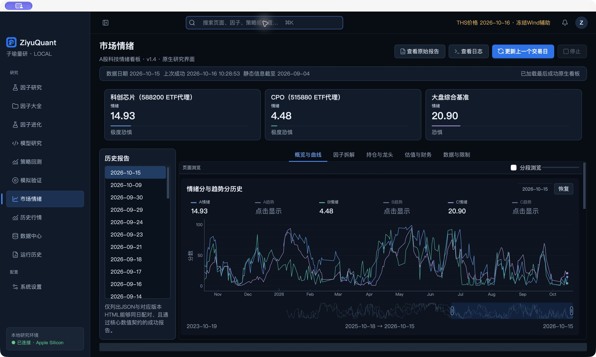

[观看实机操作：市场情绪](media/current/market-sentiment-demo.mp4)

它是观察市场状态的研究视角，不是“情绪到某个数，明天就一定涨”的交易指令。数据日期、冻结辅助组件和可见性限制会在页面里说明。

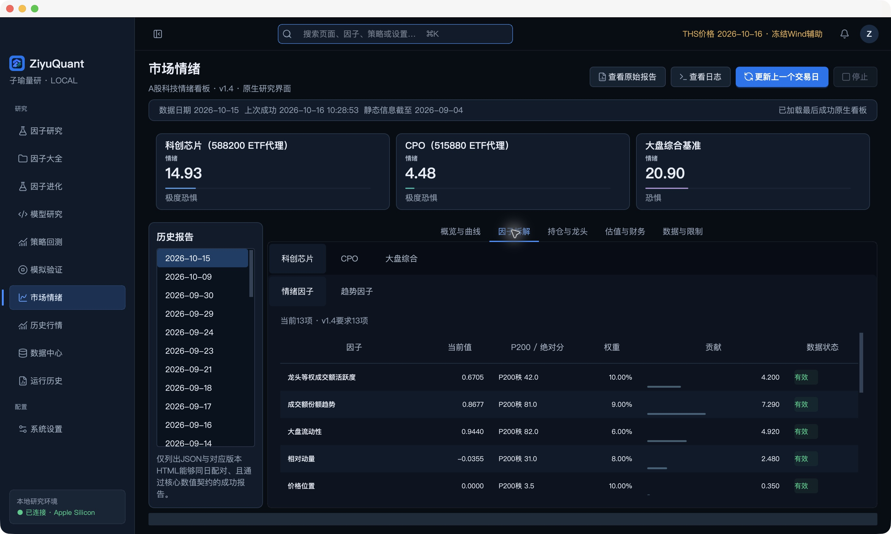

当前科创芯片与 CPO 使用 ETF 代理；最新披露的前十大持仓固定用于历史窗口，不冒充逐日历史持仓。趋势历史没有证据的部分也不回填，这些近似在「数据与限制」里明说。

## 最近重点二：因子进化，不把“模型说不错”当结论

有了一个父因子，下一步往往不是凭空造新公式，而是问：哪个环节值得改？改完和原来有多像？提升到底来自机制，还是碰巧选到了舒服的样本？

这里先冻结父因子、目标、约束、股票池、日期和处理配置，再迭代候选。既可以走确认后的模型请求，也能导出任务包、导入结构化响应；第几轮的候选，就在第几轮里看。总览、父因子诊断、候选对照、家族图谱、实验记录都围绕同一个实验身份。

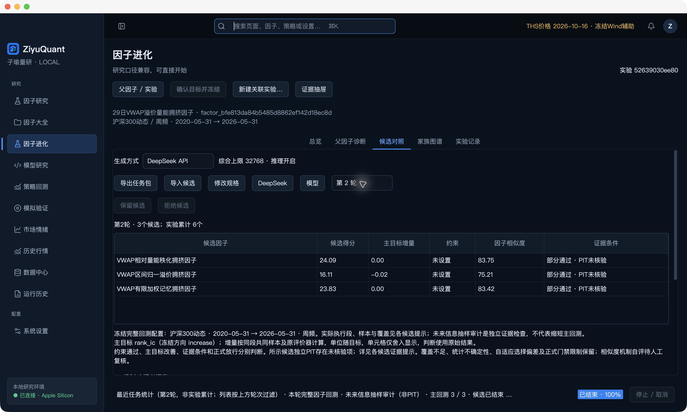

[观看实机操作：冻结实验与候选对照](media/current/factor-evolution-demo.mp4)

对照表刻意把几件事拆开：

| 项目 | 关心的事 |
| --- | --- |
| 候选得分 | 候选自己在既定评价器下表现如何 |
| 主目标增量 | 同段共同有效样本上，相比父因子改善多少 |
| 约束 | 冻结时约好的限制有没有满足 |
| 相似度 | 公式结构、真实逐股输出与机制解释分别有多像 |
| 证据条件 | 哪些检查有证据，哪些仍缺、仍受阻 |

AST 要绑定实际表达式、源码与算子版本；Pearson 按同日共同有限股票算，保留正负号，原始值和处理值分开；机制自评留着人工复核。缺一项就明确缺项，不默认塞个数把综合分凑出来。

父面板也不是按名字随便找一个：先核冻结身份，能恢复就恢复，确需补算先确认预算，多个候选共用合格父面板。候选已经完成的主研究不会因为补一项对照又整套白跑。

未来信息检查有独立的 **1% 日常抽样**与 **5% 强化抽样**。检查日期先确定，截断未来但保留原历史、预热和初始化，再真实重算。抽样没发现变化，仍然只写：

> 研究证据部分通过：本样本未发现未来依赖；独立 PIT 未核验。

候选高分、约束通过、任务结束、证据齐全、正式接受，是几件不同的事。不会因为一张表看着很绿就自动放行。

## 最近重点三：我理解的“高精度回测”

不是多显示几位小数，而是别把交易里那些不方便的细节省掉。

**收益先认日期，再认价格。** 假设周频标签约定本周一收盘到下周一收盘：A 股周一 100、周二 103，之后停牌，下周一没有有效端点报价。跳过缺值后累乘可能得到 +3%，但算到的其实是周二，不能让它冒充下周一。严格标签应该按约定的两个端点取价，缺哪端就说明缺哪端。

累乘本身没错：序列完整、口径一致时，它和两端相除可以等价。问题是偷偷跳过缺值、拿上一条记录顶上，然后还叫原来的区间收益。账户持仓的停牌估值又是另一件事，不能拿估值规则补造研究标签。

**信号也不等于成交。** 动态成分按当时名单；收盘后生成的信号按对应执行模式落到后续时点；涨停买不进、跌停卖不出，就得进入执行账。费用、停牌、持仓与现金各有规则，受阻原因留下来，不为了画完净值线乱补价。

不同执行模式有不同假设。归一化研究分层不冒充人民币账户；历史事件扩展中的假设退市结算也不冒充真实清算。IC 标签、分层研究、策略账户和模拟账户分开记账，不能偷换。

这次还做了一个只改涨跌停成交条件的对照：2023 年至 2025 年、沪深300动态、10 个预先选定的 Qlib 因子、5 层、每 5 个交易日调仓。信号、预处理、费用、次日收盘执行和事件处理全部一致，只比较涨停能不能买、跌停能不能卖。

Q1 是最高因子值组。下面是三年**累计净收益**，不是年化，也没有按收益挑选方向：

| 因子 | 忽略限价阻挡 | 启用限价阻挡 | 差值（百分点） |
| --- | ---: | ---: | ---: |
| KMID | 21.06% | 18.42% | -2.63 |
| KLEN | 8.10% | 5.92% | -2.18 |
| KLOW | 36.93% | 34.68% | -2.26 |
| VWAP0 | 12.83% | 10.82% | -2.01 |
| ROC5 | 10.33% | 9.85% | -0.48 |
| ROC20 | 16.18% | 15.67% | -0.51 |
| MA5 | 10.00% | 9.18% | -0.81 |
| MA20 | 22.41% | 21.74% | -0.67 |
| STD5 | 34.62% | 31.91% | -2.72 |
| STD20 | 43.15% | 40.95% | -2.20 |

五层合计的 50 个差异中，43 个为负、7 个为正；差异从 −4.78 到 +0.68 个百分点。过滤不是保证某一层收益必然变差，而是让不该成交的单别假装成交。小小一个开关，账已经不是原来那本账。

本次采用现有历史事件扩展模式，包含按最后记录价处理终止状态的研究假设，**不代表真实清算**。严格模式曾因海通证券缺少可靠估值停止，未填价冒充完成。逐股面板和订单明细只在内存计算，不写回 App 或共享研究缓存；完整设定、五层差异与限制见下文方法说明。

[展开看：端点、动态成员、配对、抽样与本次对照口径](docs/research-notes.md)

## 因子研究：先把一个想法看透

[观看实机操作：IC、分层收益与因子目录](media/current/factor-research-demo.mp4)

选股票池、期间和评价频率，调整 MAD、行业／市值中和、标准化，再看 IC、Rank IC、分层收益和行业／风格归因。单个分数只是入口，季度稳定性、分组单调性和暴露往往更值得细看。

可以新建或导入自己的因子，先做本地验证，再保存到因子库。研究配置、实际源码身份、数据版本和输出一起留档；不会因为改了显示精度就改变原始判断。

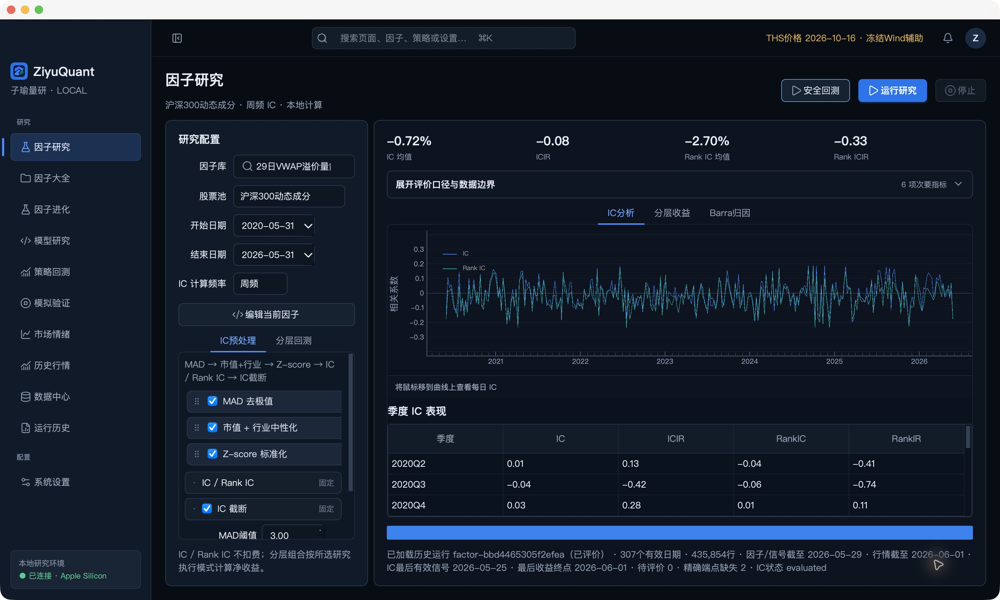

## 因子大全：让因子不再散落在文件夹里

Qlib、GTJA、WorldQuant 和个人因子统一管理，按分类、状态和关键字找。已有研究结果、验证状态、样本范围和因子画像都放回对应身份下，不用靠文件名猜“这是哪次跑的”。

“本地验证通过”不等于“有投资价值”，更不等于正式研究放行。待验证、数据不足、研究受阻这些状态仍各自保留。

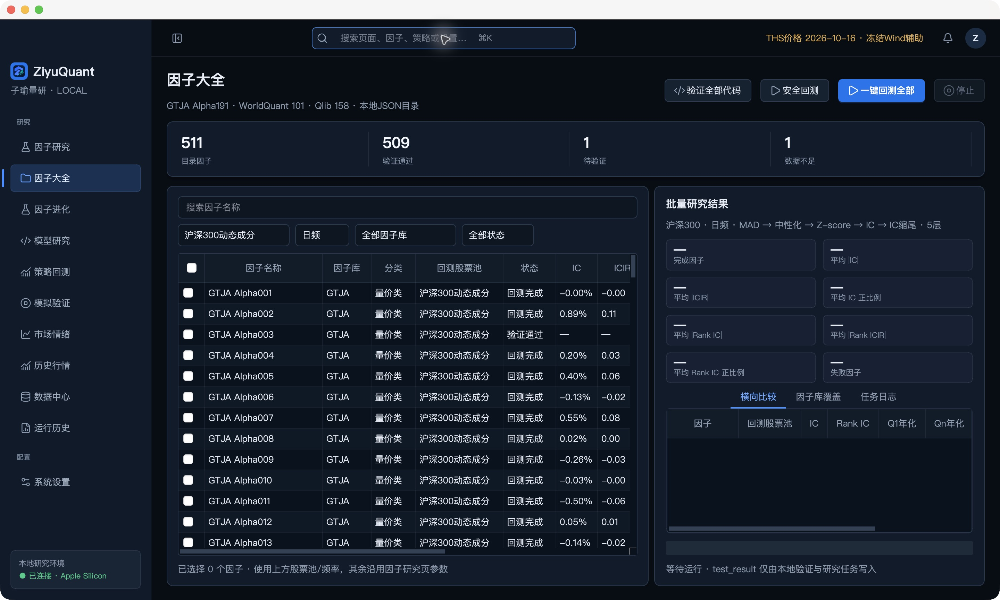

## 模型研究：训练效果和样本外表现分开看

选择特征因子，配置训练、验证和滚动窗口，把用户模型接到统一研究流程。PyTorch 在独立环境里跑，页面看样本外预测、OOS IC／Rank IC 和因子资格，而不只盯训练损失。

预测结果可以继续进入策略回测，但模型跑完不代表策略能成交。没有已有模型结果的页面就展示真实未运行状态，不临时训练一个来装门面。

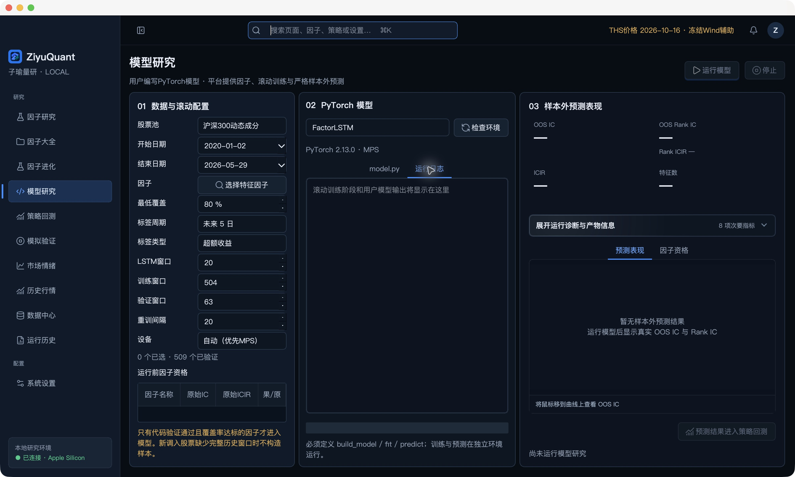

## 策略回测：从收益曲线追到订单

把信号落实到日频账户：调仓、成交时点、持有、退出缺价、费用和初始资金都有明确配置。看净值和基准，也能继续看历史持仓、成交与委托，回头问清楚某天为什么赚、为什么没买到。

研究价格、成交价格和持仓估值不混成一笔账。公司事件与总回报近似等假设会披露，不把研究假设包装成实盘执行。

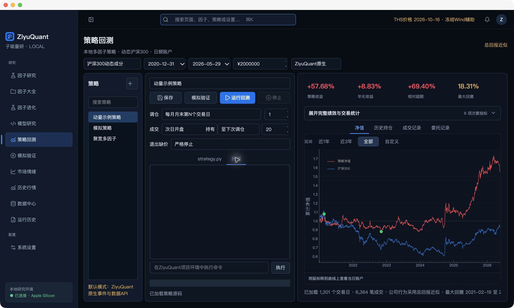

## 模拟验证：把策略放进每天的账里

三个隔离账户，分开记录信号、明日预单、订单、成交、持仓和日志。完整账户数据收进四列两行面板，现金、净值、收益和风险指标不再各套一个大框。

青蓝策略线、珊瑚红基准线、回撤标记、悬停明细和双端时间窗口都服务于查账。拖动底部缩略区间，可以聚焦一段；首显／展开的数字动效只是呈现，不代表又在计算。减少动态效果时内容照样可读。

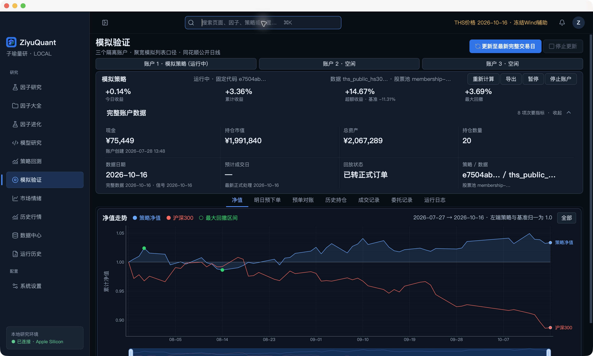

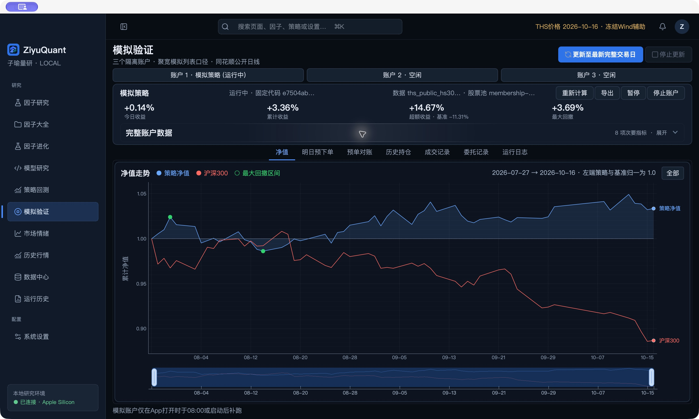

[观看实机操作：账户展开与时间窗口](media/current/simulation-demo.mp4)

这里是本地模拟与日线延迟回放，不连接券商，也不发送实盘委托。

## 历史行情：研究之外，也能直接查行情

搜索证券，按日期看日线 K 线、均线、成交与区间信息，保留缩放、拖动和悬停。数据有没有发布到那一天，会按真实覆盖显示，不把缺口补成一条理想曲线。

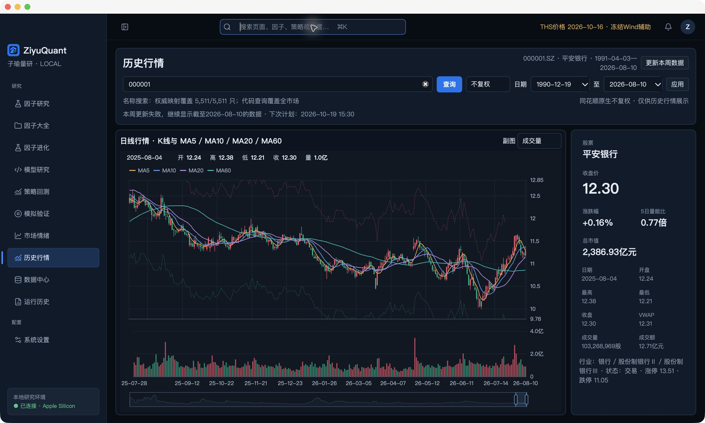

这张图保留了本机当时的「更新失败，继续显示截至 2026-08-10 的数据」提示。这是已有历史样本，不是 10 月实时行情；本次没有为了展示重新请求行情。

## 数据中心：先知道自己到底用了什么

数据集、股票池、日期覆盖、字段和运行时组件集中查看，价格口径、单位、冻结辅助输入和限制也放在这里。换一份数据，不该悄悄沿用另一份结果的身份。

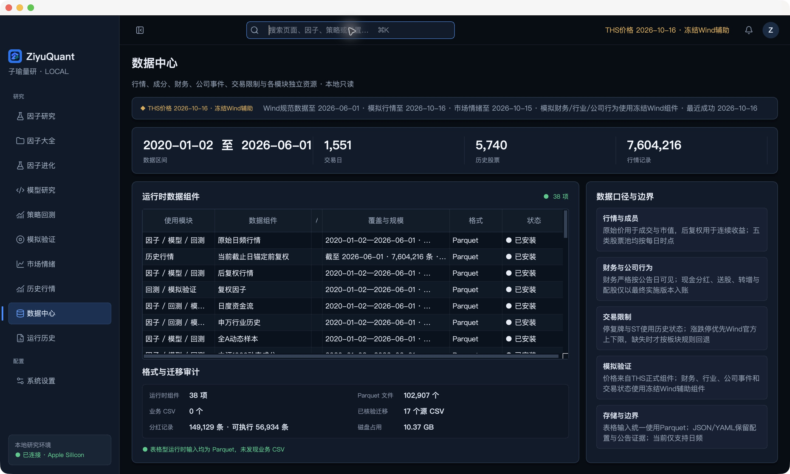

## 运行历史：结果可以回头对账

每次研究或回测保留对应的代码、配置、数据身份、状态与结果入口。完成、失败、部分完成分别记录；进度到 100% 不等于所有证据都通过，更不等于可以正式接受因子。

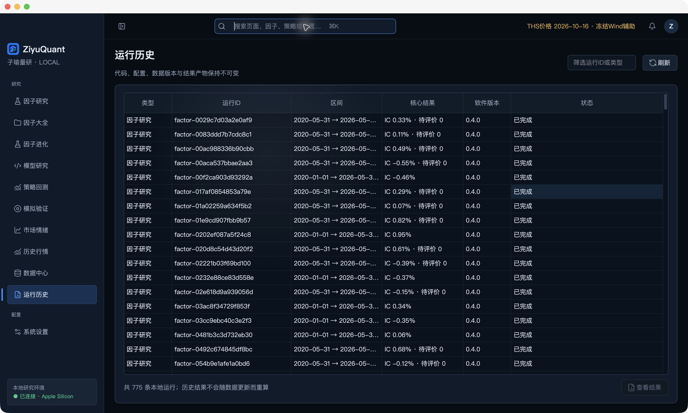

## 系统设置：让桌面按自己的习惯工作

主题、开场、减少动态效果，以及市场情绪自动更新和账户回测默认费率，都从正常设置入口管理。减少动效时功能不会跟着消失；危险操作和费用确认也不会被动画绕过去。

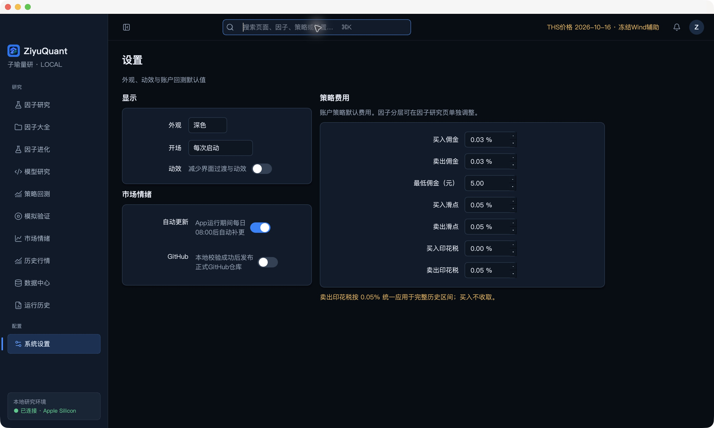

## 还有哪些边界

当前围绕 A 股日频数据研究，也能按配置做周／月频评价；不把这说成分钟、Tick 或高频交易系统。独立 PIT 未核验和正式门禁仍保留，局部审计通过不代表全链路无未来信息，也没有承诺任何收益。

这是持续打磨的个人项目。有些地方已经顺手，有些地方还会明确受阻。图可以好看，账不能糊。

本次展示页更新说明 · 2026-10-19

重新组织产品介绍，全部模块直接图文展开；替换为当前安装版实机截图，并补充静音窗口录屏。市场情绪、因子进化和回测口径放在开头。历史设计预览不再充当正式 App 展示图。本次不发布源码、数据或安装包，不把界面验收扩展为因子正式放行。

