# ZiyuQuant · 子瑜量研

> 我自己的 A 股研究工作台。先把每个数字的来路讲清楚，再聊收益。

做这个 App 的起点很简单：不想在行情软件、脚本、表格和一堆结果文件之间来回横跳。看市场、写因子、跑研究、比较新想法、回测策略，再放进模拟账户跟踪，最好能在同一个桌面里接起来。

这次把展示页也推倒重写了。先看三个最近花时间最多的地方：**市场情绪、因子进化，以及不只关心净值线的回测框架**。后面把全部 11 个模块逐个展开。

以下当前展示图片与视频来自 Swift 原生候选版 51.6／51.6.1 的实际窗口。只展示已有记录，不为拍图额外启动研究；历史回测和模拟账户不等于实盘业绩。这个仓库放产品介绍、展示素材及独立中低频回测框架源码，供量化研究者参考；不提供 App 工程源码、私有策略、原始数据或安装包。

[独立回测框架源码与使用说明](backtest-framework/README.md) · 通用框架与单独因子源码分离，包含 IC、分层、成交执行与绩效评估。数据位置仅保留用途说明，运行需自备数据。

## 软件展示：Infinitus · 无尽前海

[](https://baiziyu2002git.github.io/ZiyuQuant/media/current/opening-demo.mp4)

*开屏动画 · 约 20 秒 · 点击封面直接播放。*

**Infinitus** 取自拉丁语，意为「无限、无尽」；「前海」则来自我在深圳开发这款软件的经历。**无尽前海**，既是探索未知的愿望，也留下了这款个人作品与深圳的联系。于浩瀚中，发现秩序。

[进入在线影像页：2 分 50 秒 Swift 原生全模块实机精剪](https://baiziyu2002git.github.io/ZiyuQuant/#tour) · 直接播放。

## 最近重点一：市场情绪，把“热闹”拆开看

同样是涨，普涨、少数龙头撑场面、成交突然放大，给人的体感完全不同。我想看的不只是指数红没红，而是市场里面发生了什么。

市场走过这么多年，投资者早已形成一些相似的体会：真正的买点，常让人痛到不敢重仓；真正的卖点，又容易让人舒服到不愿离场。这便是量化研究的意义：少一点情绪驱使，多一点证据——于浩瀚中，发现秩序。

市场情绪把三个观察组合放在一张叠加图里：上面看当前指标，左边回看历史报告，右边继续拆因子、持仓与龙头、估值财务，以及数据限制。

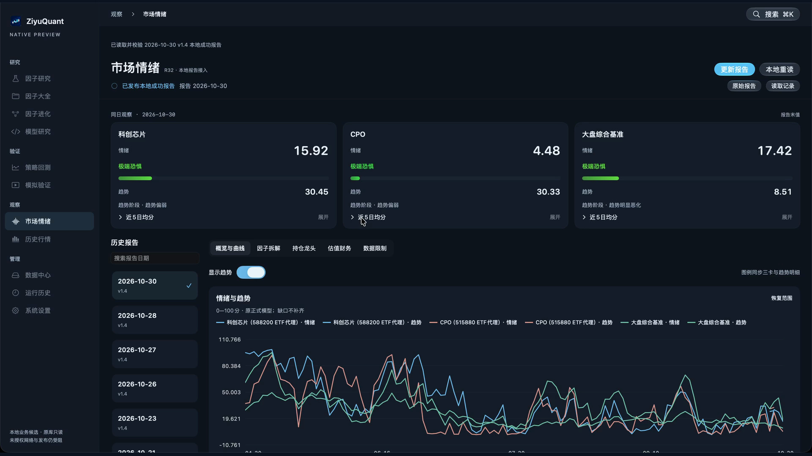

[在线播放：市场情绪](https://baiziyu2002git.github.io/ZiyuQuant/#sentiment)

它是观察市场状态的研究视角，不是“情绪到某个数，明天就一定涨”的交易指令。数据日期、冻结辅助组件和可见性限制会在页面里说明。

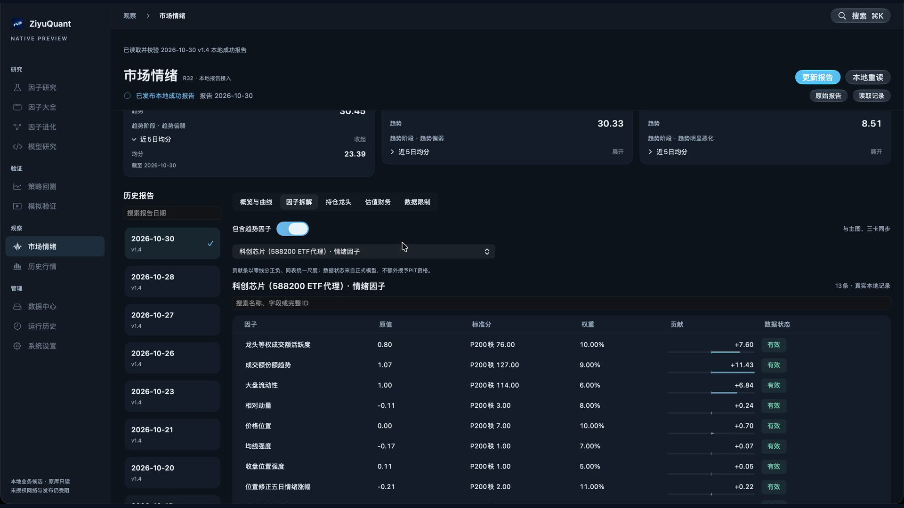

当前科创芯片与 CPO 使用 ETF 代理；最新披露的前十大持仓固定用于历史窗口，不冒充逐日历史持仓。趋势历史没有证据的部分也不回填，这些近似在「数据与限制」里明说。

## 最近重点二：因子进化，不把“模型说不错”当结论

有了一个父因子，下一步往往不是凭空造新公式，而是问：哪个环节值得改？改完和原来有多像？提升到底来自机制，还是碰巧选到了舒服的样本？

这里先冻结父因子、目标、约束、股票池、日期和处理配置，再迭代候选。既可以走确认后的模型请求，也能导出任务包、导入结构化响应；第几轮的候选，就在第几轮里看。总览、父因子诊断、候选对照、家族图谱、实验记录都围绕同一个实验身份。

我想做的，是让一个已有研究基础的单因子不断归因、进化和迭代，寻找更强的版本；是否真的改善，仍由同口径的研究证据回答。

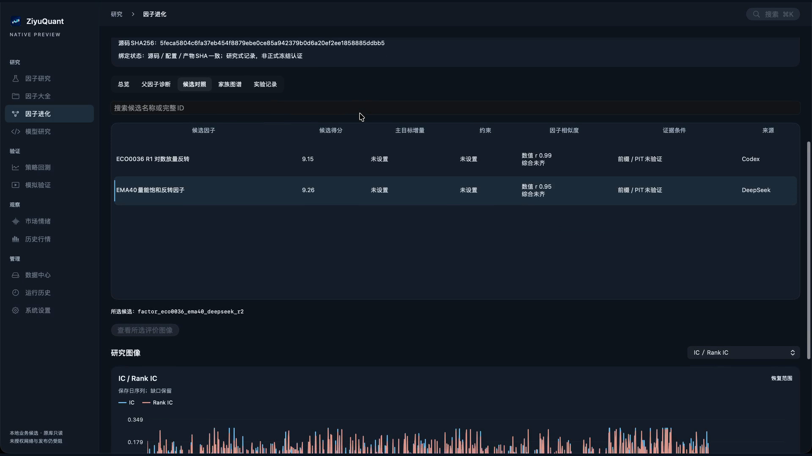

[在线播放：冻结实验与候选对照](https://baiziyu2002git.github.io/ZiyuQuant/#evolution)

对照表刻意把几件事拆开：

| 项目 | 关心的事 |
| --- | --- |
| 候选得分 | 候选自己在既定评价器下表现如何 |
| 主目标增量 | 同段共同有效样本上，相比父因子改善多少 |
| 约束 | 冻结时约好的限制有没有满足 |
| 相似度 | 公式结构、真实逐股输出与机制解释分别有多像 |
| 证据条件 | 哪些检查有证据，哪些仍缺、仍受阻 |

AST 要绑定实际表达式、源码与算子版本；Pearson 按同日共同有限股票算，保留正负号，原始值和处理值分开。

父面板也不是按名字随便找一个：先核冻结身份，能恢复就恢复，确需补算先确认预算，多个候选共用合格父面板。候选已经完成的主研究不会因为补一项对照又整套白跑。

未来信息检查有独立的 **1% 日常抽样**与 **5% 强化抽样**。检查日期先确定，截断未来但保留原历史、预热和初始化，再真实重算。抽样没发现变化，仍然只写：

> 研究证据部分通过：本样本未发现未来依赖；独立 PIT 未核验。

候选高分、约束通过、任务结束、证据齐全、正式接受，是几件不同的事。不会因为一张表看着很绿就自动放行。

## 最近重点三：我理解的“高精度回测”

不是多显示几位小数，而是别把交易里那些不方便的细节省掉。

**收益先认日期，再认价格。** 假设周频标签约定本周一收盘到下周一收盘：A 股周一 100、周二 103，之后停牌，下周一没有有效端点报价。跳过缺值后累乘可能得到 +3%，但算到的其实是周二，不能让它冒充下周一。严格标签应该按约定的两个端点取价，缺哪端就说明缺哪端。这里的端点取价规则用于 IC／Rank IC 收益标签，不改变分层回测独立的持仓、成交与计价规则。

累乘本身没错：序列完整、口径一致时，它和两端相除可以等价。问题是偷偷跳过缺值、拿上一条记录顶上，然后还叫原来的区间收益。账户持仓的停牌估值又是另一件事，不能拿估值规则补造研究标签。

### 三年十因子实测：五日累乘与现行周频 IC 有多大差别？

这次只读复用现有研究主框架的 Qlib158 因子计算器、预处理、收益标签与 `SignalAnalyzer`，不改框架源码或配置文件。先说明一个容易混淆的事实：**该框架当前已经按精确端点计算周频标签，并不是跳过缺价后累乘。**

对照组按完整五个市场交易日计算：`R₅ = ∏(1 + rᵢ) − 1`，其中每一段 `rᵢ = Pᵢ / Pᵢ₋₁ − 1`。需要连续六个有效收盘价，缺任一个就保留空值；不跳缺口、不填价，也不是把五个收益率直接相乘。

两组在同一个周频信号日观察同一份因子，但终点定义不同：

- **现行周频**：本周首个实际交易日收盘 → 下一自然周首个实际交易日收盘；下一自然周整周休市时，按框架现有实现保留空标签。
- **五日累乘**：从信号日收盘起，固定五个后续市场交易日的日收益连乘。节假日前后，它不一定等于自然周端点。

因此，下表是**两种收益窗口定义的敏感性对照，不是证明累乘或端点谁更准确**。

信号期间为 **2023-01-01 → 2025-12-31**，实际包含 727 个交易日。股票池来自历史沪深300动态成分；沿用 300 个交易日预热，以及 MAD 3 倍阈值 → 市值／行业中性化 → Z-score。每个截面至少 10 个有效样本；两组分别对共同有效周序列做 1%／99% 线性分位缩尾后求均值。IC 不扣费用，也不在本项试验中运行分层、订单或账户回放。因子输入止于研究末日，之后的行情只用于完成收益标签。

三年共有 154 个周频信号日：130 个恰好相隔五个交易日，21 个只相隔一至四个交易日，另有 3 个因下一自然周整周休市而没有现行周标签。主表只比较共同有效的 **151 周、45,298 个股票—周记录**，每一周两组使用相同股票；不把五日组额外可评的 900 条记录混进均值对比。

IC／Rank IC 以百分数展示；差值为“五日累乘 − 现行周频”，单位为百分点，按未舍入均值计算。

| 因子 | 现行周频 IC | 五日累乘 IC | ΔIC（百分点） | 现行周频 Rank IC | 五日累乘 Rank IC | ΔRank IC（百分点） |
| --- | ---: | ---: | ---: | ---: | ---: | ---: |
| KMID | 0.46% | -0.27% | -0.7315 | -0.35% | -0.82% | -0.4607 |
| KLEN | -0.70% | -1.17% | -0.4757 | -2.73% | -2.93% | -0.1961 |
| KLOW | -0.92% | -1.17% | -0.2445 | -2.04% | -2.24% | -0.1954 |
| VWAP0 | 0.77% | 1.38% | +0.6113 | 0.96% | 1.56% | +0.6007 |
| ROC5 | -0.75% | -0.02% | +0.7340 | 0.04% | 0.65% | +0.6116 |
| ROC20 | -0.72% | 0.07% | +0.7933 | 0.20% | 0.83% | +0.6303 |
| MA5 | -1.08% | -0.35% | +0.7245 | -0.38% | 0.14% | +0.5213 |
| MA20 | -0.79% | -0.03% | +0.7628 | 0.16% | 0.76% | +0.5976 |
| STD5 | -0.10% | -0.62% | -0.5200 | -2.30% | -2.66% | -0.3625 |
| STD20 | -0.32% | -0.50% | -0.1804 | -2.49% | -2.52% | -0.0314 |

**差异主要来自节假日前后的收益终点，而不是累乘本身。** 例如 2024-09-30 的现行周标签到 2024-10-08，实际只有一个交易日间隔；固定五日组则到 2024-10-14。在主表十因子中，IC 均值变化最大为 ROC20 的 +0.7933 个百分点，Rank IC 均值变化最大为 +0.6303 个百分点；不能据此宣称预测能力改善。

<details>
<summary>展开：相同五日端点控制、浮点并列排名与来源身份</summary>

为分清“区间变了”和“算法变了”，再将两组都固定为同一个五日端点。154 周的共同有效记录为 46,198 条；两组均保留另外 2 条缺价记录为空，未补零。此时：

- 逐股收益最大绝对差为 **6.66 × 10⁻¹⁶**；预先约定的核对范围为绝对误差 `1e-12` ＋ 相对误差 `1e-12`，没有超出。
- 十因子未缩尾单周 IC 的最大绝对差为 **8.40 × 10⁻¹⁶**，属于浮点尾数；现行周标签与独立端点连接复算则逐值、连同缺失掩码完全一致。
- **Rank IC 不能直接声称逐值一致。** 累乘的浮点尾数会把本来并列的收益拆开；不先舍入收益时，同五日端点的十因子 Rank IC 均值差仍可达 **0.001579 个百分点**，单周最大差为 **0.068162 个百分点**。这不是新的预测信息。

下表仍按原设置缩尾，不做收益舍入或强行合并排名。两位小数可能看不出小差，因此另列六位小数的 Rank IC 均值差；这里的样本范围与上面的 151 周主表不同，不能跨表直接作提升结论。

| 因子 | 五日端点 IC | 五日累乘 IC | 五日端点 Rank IC | 五日累乘 Rank IC | ΔRank IC（百分点） |
| --- | ---: | ---: | ---: | ---: | ---: |
| KMID | -0.39% | -0.39% | -0.96% | -0.96% | -0.000762 |
| KLEN | -0.97% | -0.97% | -2.77% | -2.77% | -0.000249 |
| KLOW | -1.23% | -1.23% | -2.27% | -2.27% | +0.000549 |
| VWAP0 | 1.57% | 1.57% | 1.72% | 1.72% | +0.000703 |
| ROC5 | 0.16% | 0.16% | 0.86% | 0.86% | -0.000161 |
| ROC20 | 0.17% | 0.17% | 1.02% | 1.02% | -0.000204 |
| MA5 | -0.22% | -0.22% | 0.34% | 0.34% | -0.000180 |
| MA20 | 0.11% | 0.11% | 0.95% | 0.95% | -0.000427 |
| STD5 | -0.31% | -0.31% | -2.37% | -2.38% | -0.001579 |
| STD20 | -0.37% | -0.37% | -2.34% | -2.34% | -0.000179 |

对最大单周差案例 STD20（2025-06-03）另用中心化内积、SciPy 平均秩和高精度十进制进行复核，相关计算一致。在完整同五日样本中，共有 354 条股票—周收益排名发生变化，全部属于端点收益的并列组；仅在诊断中恢复这些并列关系后，排名差归零。**这一诊断没有改写原框架，也没有参与以上两表取数。** 将累乘窗口改为与现行自然周完全相同后，45,298 条共同收益的最大差同样只有 6.66 × 10⁻¹⁶。

三处“下一自然周无交易日”的信号为 2023-01-16、2023-09-25、2024-02-05；两处两组均缺价的信号为 600837.SH 的 2025-03-03、601989.SH 的 2025-09-01。本轮如实保留这些边界，没有修改标签规则或证券历史。

本次固定的十个特征编号为 **1、2、6、13、14、16、19、21、24、26**，不是按 IC 或收益挑选。复核日期为 **2026-11-04**；只读计算的源码／数据身份如下（SHA-256）：

- 动态成分与行情：`76045cea3afc0acbac98801eb479ae8dbc77151bc0dc100a7bc15cf6ba16abb2`。
- 全A后复权行情：`45051abaa152054130f55b7cac592220ddd7d88324f9f591ada9bdc2f275b5ae`。
- 现行控制器：`6a4cc4089891e3c57b630555c1b9d635896ac971d7cc4806972e5eb2e7726e3a`。
- IC／Rank IC 分析器：`c6a4eb3c245ca9c5af4c8f86a86a058a21094b0a509566973bcd14edca37abd9`。
- Qlib158 计算器：`dd97f036b588bf35e4a7f543e464d68d24fd9b9eebf142292a326683ec5d7c78`。
- 原配置文件：`63ee98355fac7e49cd7b230baeea6b171b543296000b4922a4e7ce09842462a1`；日期与频率仅在进程内按本项试验覆盖，原文件不改。

主表未舍入均值如下，数值是相关系数本身，**不是百分数**；已经按上述设置缩尾，不要与“未缩尾”混淆：

```json
[
  {
    "factor": "KMID",
    "ic_current": 0.004622057003786901,
    "ic_compound5": -0.0026926004049792887,
    "rank_ic_current": -0.0035453587842121403,
    "rank_ic_compound5": -0.008152716922963552
  },
  {
    "factor": "KLEN",
    "ic_current": -0.006981312589025651,
    "ic_compound5": -0.011738732931370996,
    "rank_ic_current": -0.027347959664147208,
    "rank_ic_compound5": -0.029308849689241342
  },
  {
    "factor": "KLOW",
    "ic_current": -0.009241310802266556,
    "ic_compound5": -0.011686787129965556,
    "rank_ic_current": -0.020431415626085428,
    "rank_ic_compound5": -0.022384997875745327
  },
  {
    "factor": "VWAP0",
    "ic_current": 0.007675772559175347,
    "ic_compound5": 0.013788973030884251,
    "rank_ic_current": 0.009550575023289098,
    "rank_ic_compound5": 0.015557883305381342
  },
  {
    "factor": "ROC5",
    "ic_current": -0.007503511574867643,
    "ic_compound5": -0.00016369569838758555,
    "rank_ic_current": 0.0004291379791589397,
    "rank_ic_compound5": 0.006544699338417905
  },
  {
    "factor": "ROC20",
    "ic_current": -0.007229496372656135,
    "ic_compound5": 0.0007030861346580084,
    "rank_ic_current": 0.0019874325531257582,
    "rank_ic_compound5": 0.00829002514486223
  },
  {
    "factor": "MA5",
    "ic_current": -0.010786166162634968,
    "ic_compound5": -0.003540728377961317,
    "rank_ic_current": -0.0037944136356712647,
    "rank_ic_compound5": 0.0014190167002214576
  },
  {
    "factor": "MA20",
    "ic_current": -0.007937066717289493,
    "ic_compound5": -0.00030916412977110164,
    "rank_ic_current": 0.001590585259735763,
    "rank_ic_compound5": 0.007566957005414284
  },
  {
    "factor": "STD5",
    "ic_current": -0.0009882780261369875,
    "ic_compound5": -0.0061878804542466965,
    "rank_ic_current": -0.02297281702053502,
    "rank_ic_compound5": -0.02659742903544636
  },
  {
    "factor": "STD20",
    "ic_current": -0.0031859347536891867,
    "ic_compound5": -0.004990398042291769,
    "rank_ic_current": -0.024867301018601833,
    "rank_ic_compound5": -0.025181183232197518
  }
]
```

十因子主试验正常完成，用时 57.52 秒；另做一次 STD20 定向复核。计算进程禁止联网与文件写入，禁用字节码输出；未调用绘图、日志落盘、结果保存或共享缓存入口。为避开控制器导入绘图库时的磁盘缓存需求，仅在内存原样加载其类定义，收益方法未改。所用主框架的 src／factor_lib 源码、配置和两份输入数据的前后哈希一致。只将本节汇总写入 README，不保存逐股面板、IC 时序或中间文件，不写回 App；这也不是独立 PIT 认证。

</details>

**信号也不等于成交。** 动态成分按当时名单；收盘后生成的信号按对应执行模式落到后续时点；涨停买不进、跌停卖不出，就得进入执行账。费用、停牌、持仓与现金各有规则，受阻原因留下来，不为了画完净值线乱补价。

不同执行模式有不同假设。归一化研究分层不冒充人民币账户；历史事件扩展中的假设退市结算也不冒充真实清算。IC 标签、分层研究、策略账户和模拟账户分开记账，不能偷换。

这次还做了一个只改涨跌停成交条件的对照：2023 年至 2025 年、沪深300动态、10 个预先选定的 Qlib 因子、5 层、每 5 个交易日调仓。信号、预处理、费用、次日收盘执行和事件处理全部一致，只比较涨停能不能买、跌停能不能卖。

Q1 是最高因子值组。下面是三年**累计净收益**，不是年化，也没有按收益挑选方向：

| 因子 | 忽略限价阻挡 | 启用限价阻挡 | 差值（百分点） |
| --- | ---: | ---: | ---: |
| KMID | 21.06% | 18.42% | -2.63 |
| KLEN | 8.10% | 5.92% | -2.18 |
| KLOW | 36.93% | 34.68% | -2.26 |
| VWAP0 | 12.83% | 10.82% | -2.01 |
| ROC5 | 10.33% | 9.85% | -0.48 |
| ROC20 | 16.18% | 15.67% | -0.51 |
| MA5 | 10.00% | 9.18% | -0.81 |
| MA20 | 22.41% | 21.74% | -0.67 |
| STD5 | 34.62% | 31.91% | -2.72 |
| STD20 | 43.15% | 40.95% | -2.20 |

五层合计的 50 个差异中，43 个为负、7 个为正；差异从 −4.78 到 +0.68 个百分点。过滤不是保证某一层收益必然变差，而是让不该成交的单别假装成交。小小一个开关，账已经不是原来那本账。

本次采用现有历史事件扩展模式，包含按最后记录价处理终止状态的研究假设，**不代表真实清算**。逐股面板和订单明细只在内存计算，不写回 App 或共享研究缓存；完整设定、五层差异与限制见下文方法说明。

[展开看：端点、动态成员、配对、抽样与本次对照口径](docs/research-notes.md)

## 因子研究：先把一个想法看透

[在线播放：IC、分层收益与因子目录](https://baiziyu2002git.github.io/ZiyuQuant/#research)

选股票池、期间和评价频率，调整 MAD、行业／市值中和、标准化，再看 IC、Rank IC、分层收益和行业／风格归因。单个分数只是入口，季度稳定性、分组单调性和暴露往往更值得细看。

可以新建或导入自己的因子，先做本地验证，再保存到因子库。研究配置、实际源码身份、数据版本和输出一起留档；不会因为改了显示精度就改变原始判断。

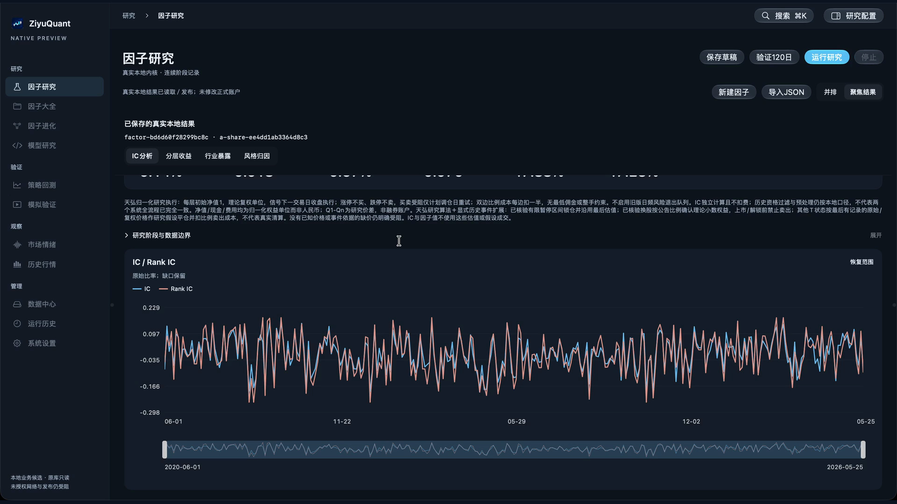

## 因子大全：让因子不再散落在文件夹里

Qlib、GTJA、WorldQuant 和个人因子统一管理，按分类、状态和关键字找。已有研究结果、验证状态、样本范围和因子画像都放回对应身份下。

“本地验证通过”不等于“有投资价值”，更不等于正式研究放行。待验证、数据不足、研究受阻这些状态仍各自保留。

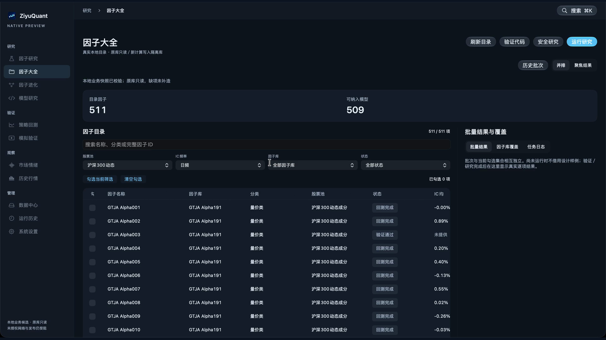

## 模型研究：训练效果和样本外表现分开看

选择特征因子，配置训练、验证和滚动窗口，把用户模型接到统一研究流程。PyTorch 在独立环境里跑，页面看样本外预测、OOS IC／Rank IC 和因子资格，而不只盯训练损失。

预测结果可以继续进入策略回测，但模型跑完不代表策略能成交。没有已有模型结果的页面就展示真实未运行状态，不临时训练一个来装门面。

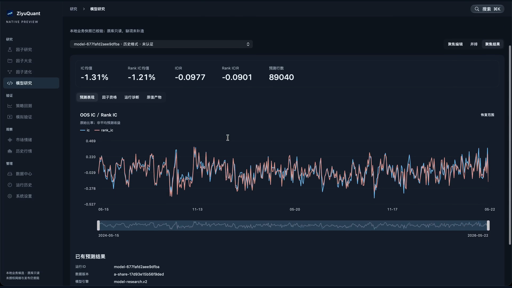

## 策略回测：从收益曲线追到订单

把信号落实到日频账户：调仓、成交时点、持有、退出缺价、费用和初始资金都有明确配置。看净值和基准，也能继续看历史持仓、成交与委托，回头问清楚某天为什么赚、为什么没买到。

研究价格、成交价格和持仓估值不混成一笔账。公司事件与总回报近似等假设会披露，不把研究假设包装成实盘执行。

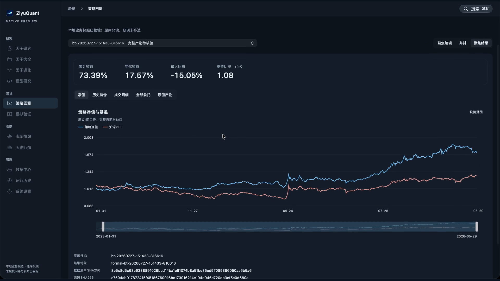

## 模拟验证：把策略放进每天的账里

三个隔离账户，分开记录信号、明日预单、订单、成交、持仓和日志。完整账户数据收进四列两行面板，现金、净值、收益和风险指标不再各套一个大框。

策略线、基准线、回撤标记、悬停明细和双端时间窗口都服务于查账。拖动底部缩略区间可以聚焦一段，也可以按策略信号查看下一交易日的模拟预单，再按账户配置的时点尝试执行。预单不等于成交，信号生成与执行时点分开，避免把事后信息带回过去。

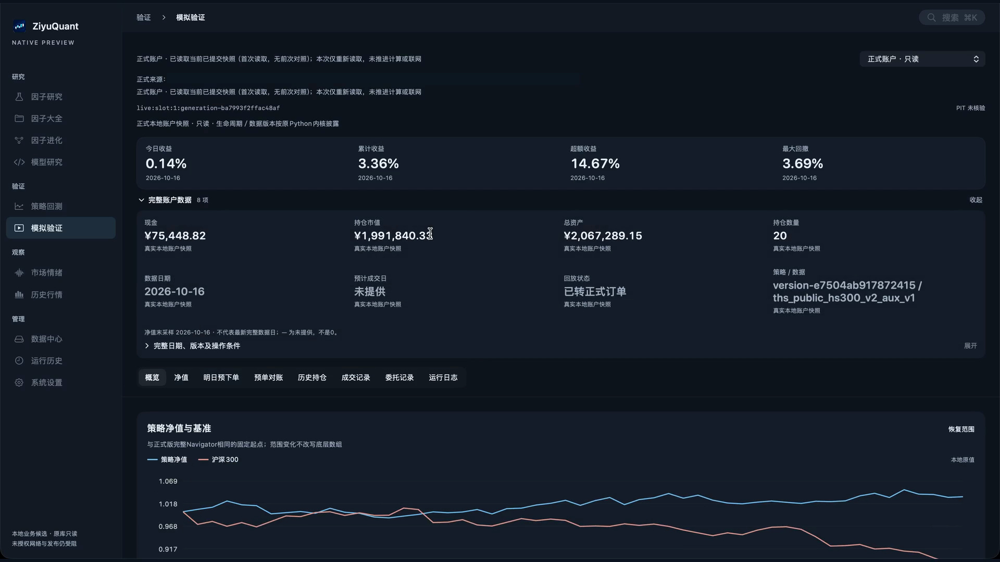

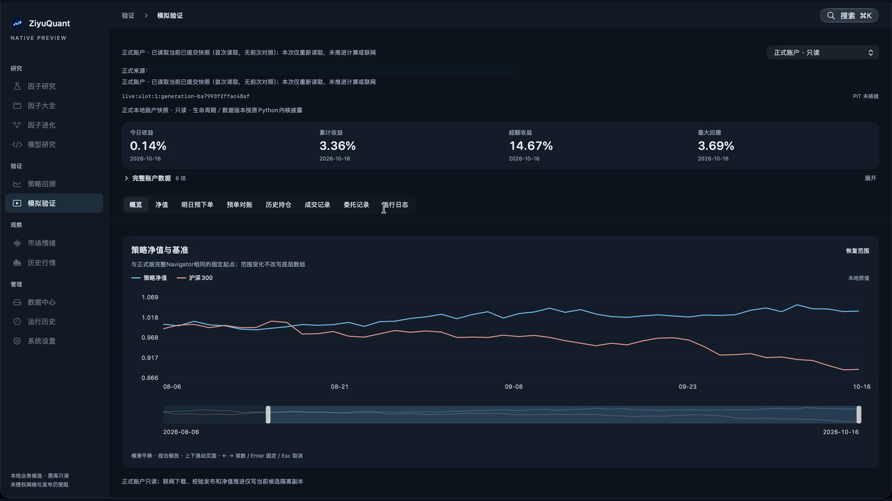

[在线播放：账户展开与时间窗口](https://baiziyu2002git.github.io/ZiyuQuant/#simulation)

这里是本地模拟与日线延迟回放，不连接券商，也不发送实盘委托。

## 历史行情：研究之外，也能直接查行情

搜索证券，按日期看日线 K 线、均线、成交与区间信息，保留缩放、拖动和悬停。数据有没有发布到那一天，会按真实覆盖显示，不把缺口补成一条理想曲线。

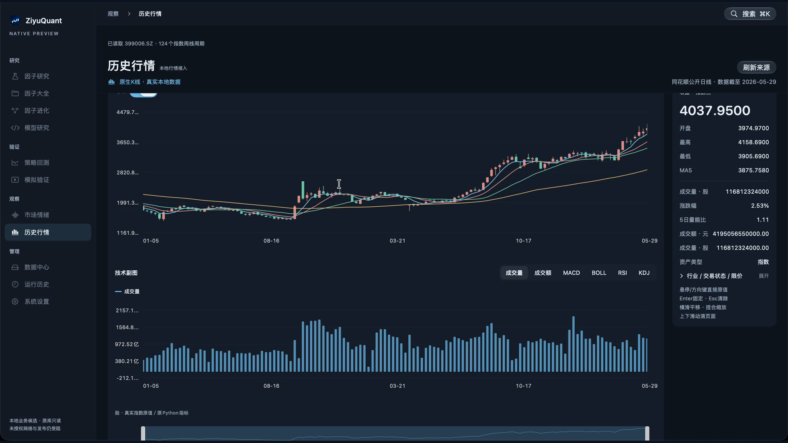

截图保留真实历史覆盖：股票样本截至 2026-08-10，指数样本截至 2026-05-29，不是实时行情。

[在线播放：历史行情](https://baiziyu2002git.github.io/ZiyuQuant/#historical-quotes)

## 数据中心：先知道自己到底用了什么

数据集、股票池、日期覆盖、字段和运行时组件集中查看，价格口径、单位、冻结辅助输入和限制也放在这里。换一份数据，不该悄悄沿用另一份结果的身份。

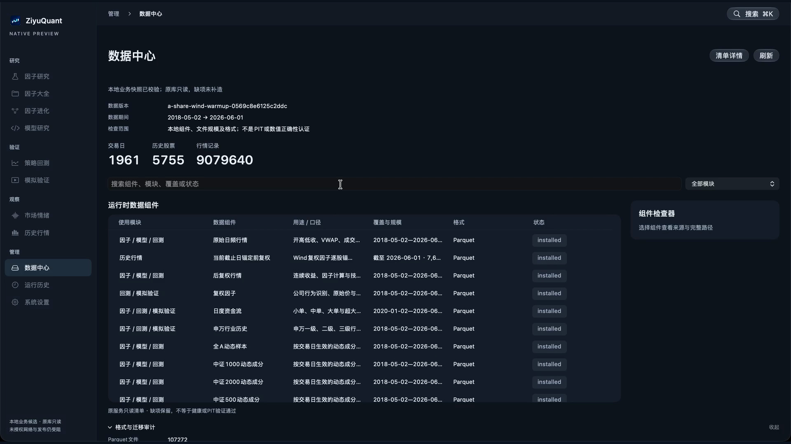

[在线播放：数据中心](https://baiziyu2002git.github.io/ZiyuQuant/#data-center)

## 运行历史：结果可以回头对账

每次研究或回测保留对应的代码、配置、数据身份、状态与结果入口。完成、失败、部分完成分别记录；进度到 100% 不等于所有证据都通过，更不等于可以正式接受因子。

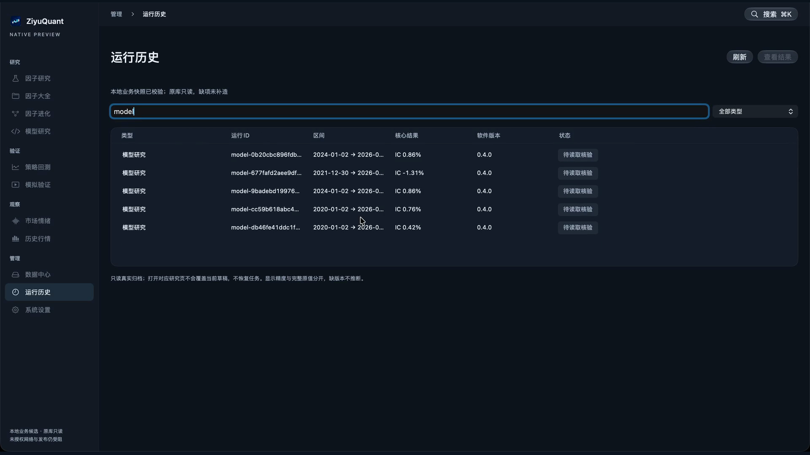

## 系统设置：让桌面按自己的习惯工作

主题、开场、减少动态效果，以及市场情绪自动更新和账户回测默认费率，都从正常设置入口管理。减少动效时功能不会跟着消失；危险操作和费用确认也不会被动画绕过去。

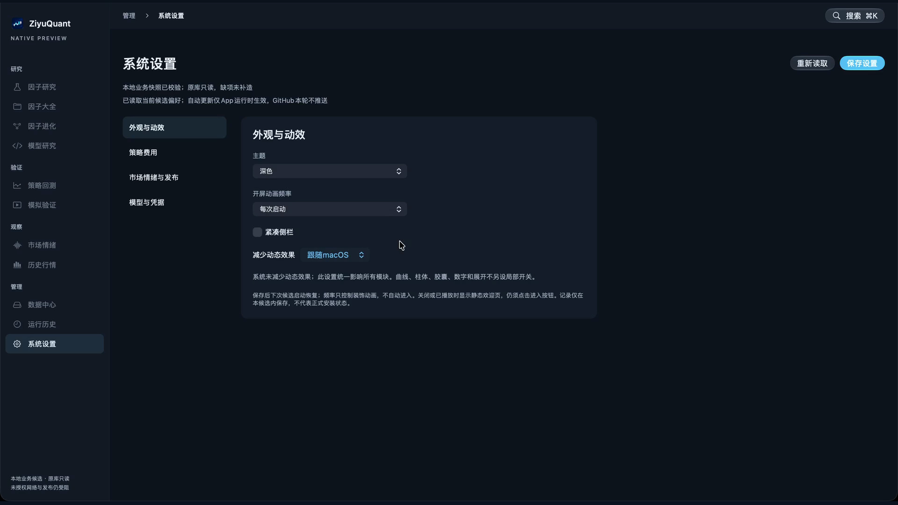

## 还有哪些边界

当前围绕 A 股日频数据研究，也能按配置做周／月频评价；不把这说成分钟、Tick 或高频交易系统。独立 PIT 未核验和正式门禁仍保留，局部审计通过不代表全链路无未来信息，也没有承诺任何收益。

这是持续打磨的个人项目。有些地方已经顺手，有些地方还会明确受阻。图可以好看，账不能糊。

<details>
<summary>历史展示页更新说明 · 2026-10-19</summary>

重新组织产品介绍，全部模块直接图文展开；替换为当前安装版实机截图，并补充静音窗口录屏。市场情绪、因子进化和回测口径放在开头。历史设计预览不再充当正式 App 展示图。本次不发布源码、数据或安装包，不把界面验收扩展为因子正式放行。

</details>


## 本次素材更新 · 2026-11-03

八支视频与十三张当前截图已替换为原生实录，包含开场动画；专题音乐使用不同乐段。操作保持原速，不插帧、不以剪辑时长或 60fps 编码宣称 App 实际帧率。当前展示不等于全部功能验收。

配乐：[“Tears in Rain” by Scott Buckley](https://www.scottbuckley.com.au/library/tears-in-rain/)，[CC BY 4.0](https://creativecommons.org/licenses/by/4.0/)。已节选、平衡音量并淡入淡出，署名保留在每支片尾。

[在线播放：原生开场](https://baiziyu2002git.github.io/ZiyuQuant/#opening) · [查看独立回测框架](backtest-framework/README.md)
