# ZiyuQuant / 子瑜量研

> 一个在本地跑的 A 股日频量化研究工作台。

这个仓库是我第一次把 ZiyuQuant 整理出来做公开介绍。它不是开源项目，也没有下载、安装或体验入口；我只是想把自己比较在意的一条研究链路记录下来：从因子研究，到策略回测，再到模拟验证和结果回看，尽量让每一步都能对得上。

**This repository is a product and research showcase only. Source code, datasets and application binaries are not distributed.**

## 先说清楚展示边界

- 这里会放产品界面、研究结果、方法说明，以及界面中正常可见的因子 / 策略 / 模型研究脚本；这些截图不是源码交付，也不附带可下载代码或授权。
- 不提供项目源文件、完整工程实现、原始数据、安装包、数据库和运行环境。
- 图中的回测、模拟账户和研究指标均为本地研究界面的展示，不是实盘业绩，也不构成投资建议。

## 截图版本

本目录的 12 张图片均在 **2026-08-02** 直接从当前运行的 ZiyuQuant 截取。当前安装数据状态显示：THS 价格、市场情绪和模拟行情截至 2026-07-31；冻结 Wind 辅助数据截至 2026-06-01。因子研究图已在本次截图前按当前默认配置重新计算。

## 我想解决什么问题

一开始我也会先看一条净值线，但后来发现真正容易出问题的地方通常不在曲线上：信号是哪天看见的、成交按什么价、费用和现金是怎么走的、分红送转又有没有被复权价格悄悄“抹平”。

所以 ZiyuQuant 更像一个给自己用的研究工作台。它目前围绕 A 股日频场景，重点是把研究、回测、模拟回放和结果核对放在同一套界面里。

## 1. 因子研究：先把单因子看明白

截图位置：[`media/01-主工作台-因子研究.png`](media/01-主工作台-因子研究.png)

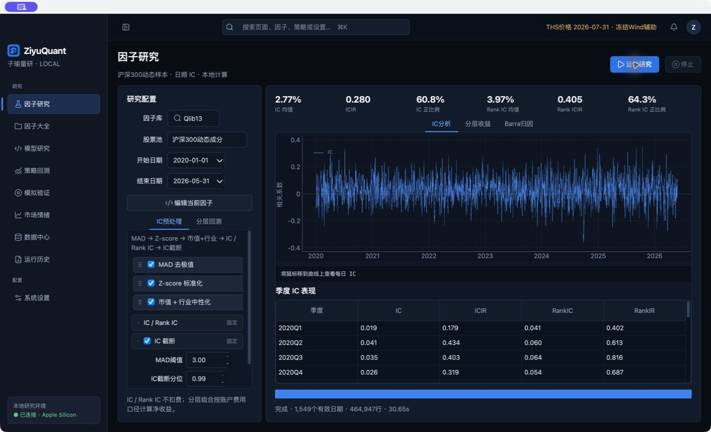

我不太想只给一个 IC 均值就结束，所以这里把 IC / Rank IC、分层收益、预处理步骤和按季度拆开的结果一起放出来。这样看因子时，至少能顺手问一句：它是长期有一点效果，还是刚好碰上一段行情。

截图位置：[`media/02-因子代码与IC分析.png`](media/02-因子代码与IC分析.png)

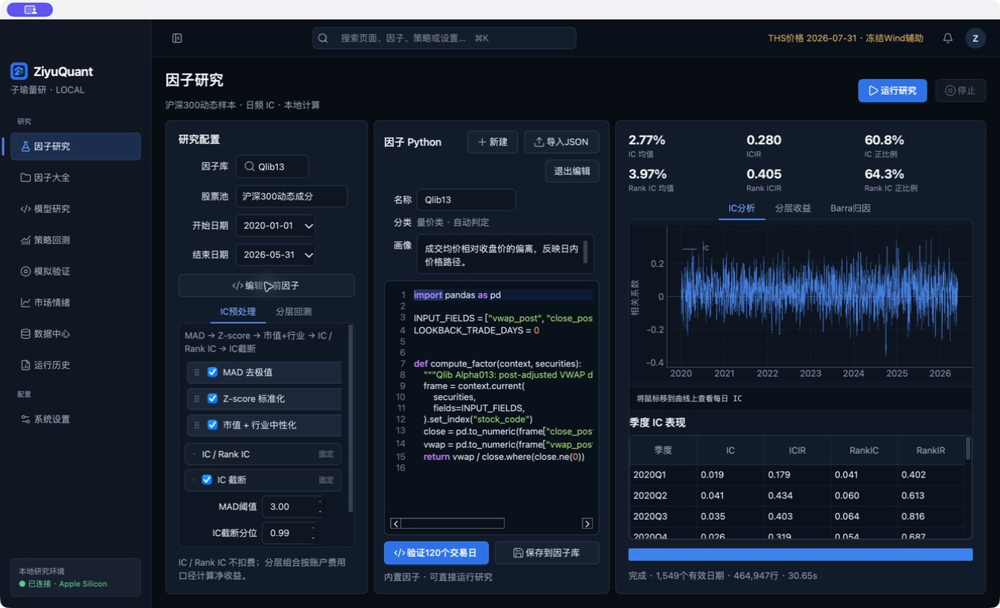

因子表达式可以在界面里直接看和改，右边紧接着就是同一份研究的 IC 图。这里展示的是研究脚本本身，不是 App 的工程源码；我希望研究逻辑和研究结果不要完全分家。

截图位置：[`media/03-因子大全与批量研究.png`](media/03-因子大全与批量研究.png)

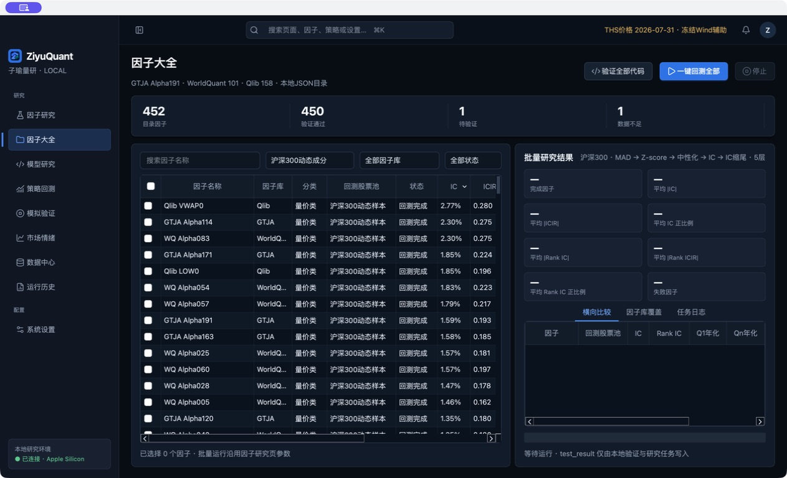

因子库目前把不同来源的条目放在一起管理，常用的筛选、状态和批量研究入口都集中在这页。做这块不是为了凑一个很大的数字，主要是避免因子一多之后，自己也说不清哪个做过、哪个没做完。

## 2. 策略回测：研究价和账户价分开看

截图位置：[`media/04-策略代码与净值回测.png`](media/04-策略代码与净值回测.png)

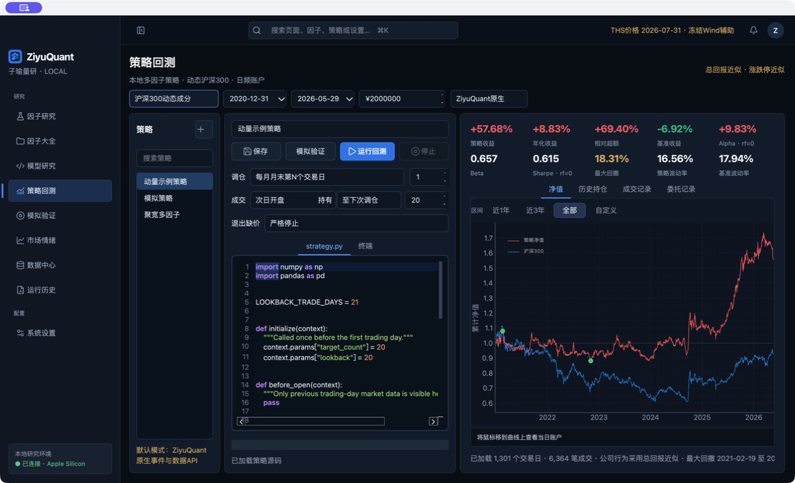

策略页左边是研究策略脚本，右边是净值、基准和回撤等结果。我在这里比较坚持的一点，是不要用同一套价格同时解决“做指标”和“算账户”两件事：指标可以使用连续研究价格，实际成交、现金和市值还是按账户口径走。

截图位置：[`media/05-净值基准回撤导航.png`](media/05-净值基准回撤导航.png)

这张图单独放出来，是因为我自己看回测时经常拖动时间范围。左端日期一变，策略净值和基准都会从 1 重新起算；图上也会标出最大回撤发生的区间。它不告诉我“策略一定好”，但能比较快看出不好是从哪段开始的。

## 3. 模拟验证：把“明天的单”和“今天的持仓”分开

截图位置：[`media/06-模拟验证账户隔离.png`](media/06-模拟验证账户隔离.png)

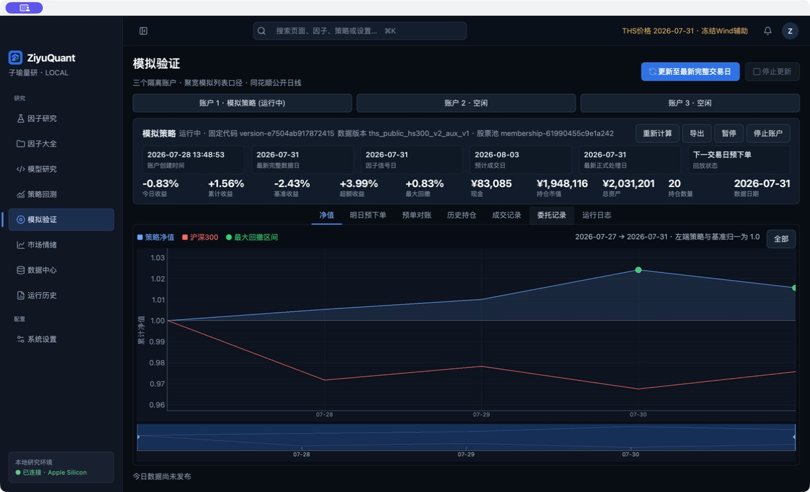

模拟验证准备了三个互相隔离的账户。空账户不是为了显得功能很多，而是为了让不同思路的测试别互相污染；它们都只是本地日频的延迟回放，不连接券商。

截图位置：[`media/07-模拟验证-明日预下单.png`](media/07-模拟验证-明日预下单.png)

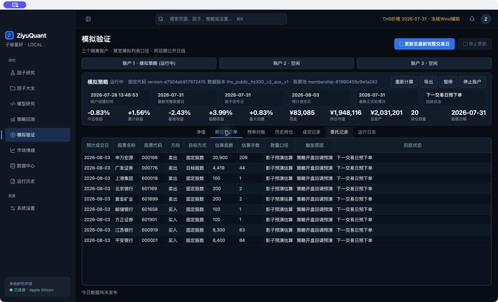

这一页专门保留“明日预下单”。如果当天因子和信号已经生成，下一交易日的预单会先出现，之后再和正式订单对照。这样遇到停牌、涨跌停、现金或取整问题时，不用只靠猜。

截图位置：[`media/08-模拟验证-历史持仓与盈亏.png`](media/08-模拟验证-历史持仓与盈亏.png)

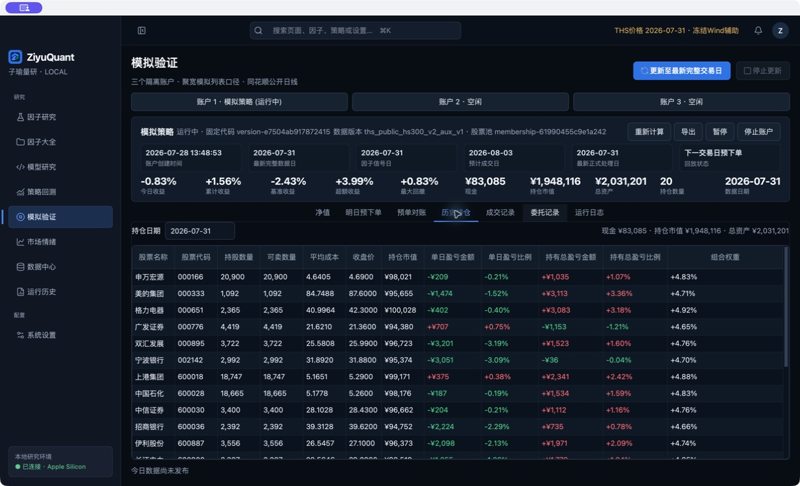

历史持仓表把收盘价、单日盈亏、持有总盈亏和组合权重放在一起，并支持按列排序。这个页面本质上还是为了对账：净值有变化时，我想能顺着看到它来自哪一天、哪类持仓，而不是只有一个总数。

## 4. 模型研究：样本外结果不要只留一个结论

截图位置：[`media/09-模型研究与滚动训练配置.png`](media/09-模型研究与滚动训练配置.png)

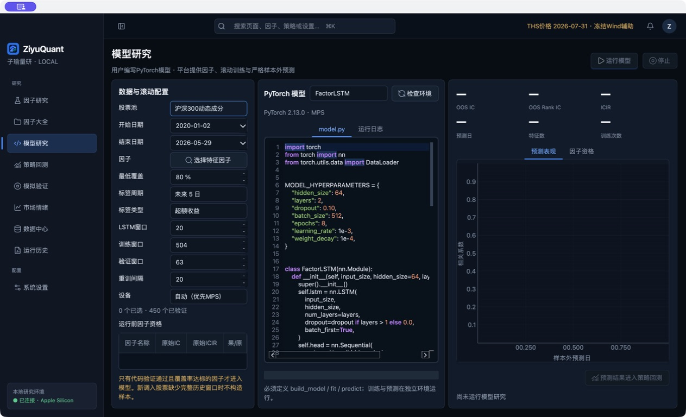

模型研究页支持把已验证的因子接进滚动训练，也允许在界面里查看模型脚本。这一张是当前版本的训练配置与代码界面；本次没有为了截图强行挑选特征或补跑模型，所以结果区保持未运行状态。模型跑通以后，样本外 IC 和预测表现会继续留在同一页，但它们也只作研究记录，不代表模型已经有效，更不是买卖建议。

## 5. 市场情绪：给研究一个更直观的背景

截图位置：[`media/10-市场情绪趋势看板.png`](media/10-市场情绪趋势看板.png)

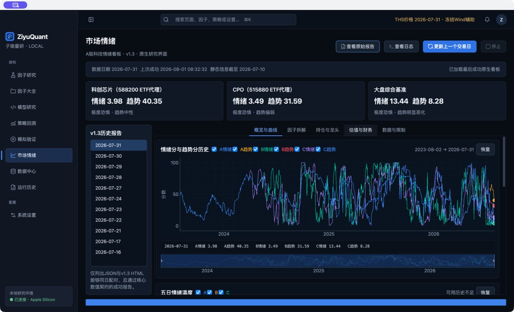

市场情绪页把几个观察方向的情绪分、趋势分和历史曲线放在一起，也保留时间导航和悬停高光。它更像我做研究时的“背景板”，不是一个告诉人该追什么题材的信号机。

## 6. 数据与审计：至少知道结果从哪里来

截图位置：[`media/11-数据中心与研究边界.png`](media/11-数据中心与研究边界.png)

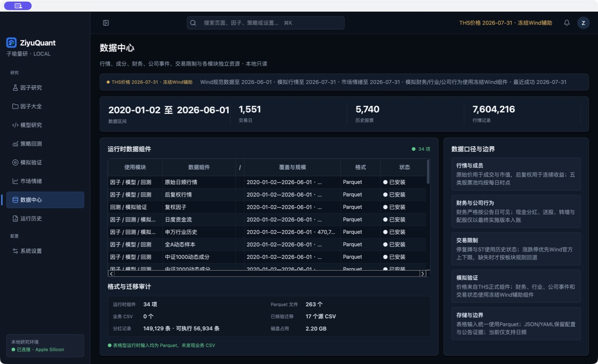

数据中心展示行情、动态成分、财务、公司行为和交易状态等研究会用到的组成，也把原始价、后复权价和研究边界写在界面里。这里不公开任何原始数据文件，只展示我如何理解这些数据在系统里的位置。

截图位置：[`media/12-运行历史与结果审计.png`](media/12-运行历史与结果审计.png)

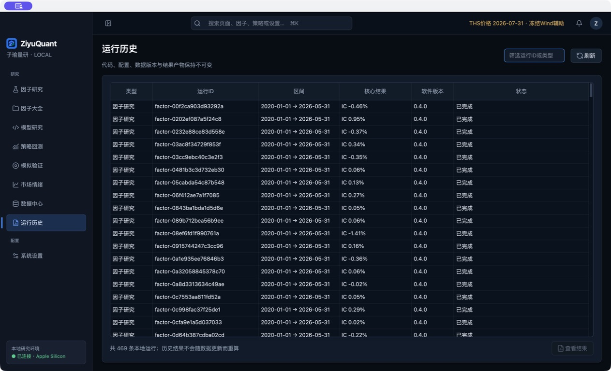

研究并不是点一次“运行”就算结束。我希望历史结果、区间、核心指标和状态能被回看；至少过一段时间以后，还能知道眼前这张图大概是怎么来的。

## 当前范围与提醒

- 当前定位是 A 股 **日频**研究，不支持实时行情、分钟 / Tick 研究或真实券商下单。
- 模拟验证是延迟日线回放，不等同于实盘清算。
- 回测结果受样本区间、股票池、费用、信号与成交口径等设定影响；历史表现不代表未来。
- 这个仓库只展示产品与研究过程，不提供源码、数据、策略包或应用二进制。

如果你也做过一点量化研究，大概会理解我为什么一直想把这些“看起来很琐碎”的东西放进同一个工作台里。漂亮的曲线当然好看，但我更想知道它是怎么走到那里的。
