# 无尽前海 · ZiyuQuant

这是我用来看 A 股、读研报和试因子的工作台。我想回答的问题都挺具体：一个指标过去有用吗？两个好看的因子，买的是不是同一批股票？回测说该买，那天真的买得进吗？

**为什么叫「无尽前海」？** 拉丁语 *infinitus* 意为「无尽」。我现在在深圳，前海是深圳的一个核心区域，就借了它的名字。「无尽」说的是总有问题值得继续研究，「前海」记的是我做这个工作台的地方。

[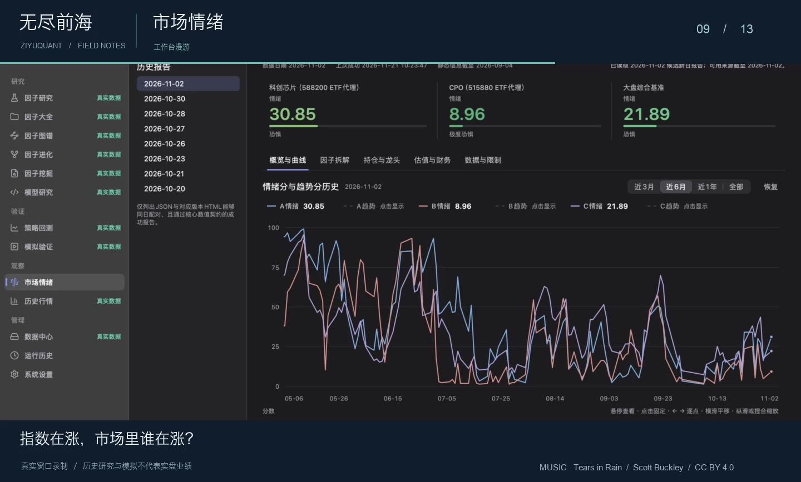](https://baiziyu2002git.github.io/ZiyuQuant/media/current/all-modules-tour.mp4)

**置顶总览** · 同一个窗口，一镜到底，中文字幕。[打开影像页](https://baiziyu2002git.github.io/ZiyuQuant/#tour) ｜ [本地视频](media/current/all-modules-tour.mp4)

## 最近更新

**[因子图谱](https://baiziyu2002git.github.io/ZiyuQuant/#atlas)**：先看看库里哪些因子相似，再用八轴雷达看它们放在一起补了什么、还缺什么。

**[因子挖掘](https://baiziyu2002git.github.io/ZiyuQuant/#mining)**：从研报原文一路查到候选和回测成绩，值不值得入库，由你定门槛。

## 模块使用指南

新更新的**因子图谱**和**因子挖掘**放在最前面。每节末尾都能直接打开该模块的视频：「操作专题」展示具体交互，「总览节选」只展示对应页面，不代表片中运行了整套流程。

### 因子图谱

手里已经有几个因子时，这页帮你判断：新加的那个到底补了什么？

- 选股票池、看单个因子的历史成绩，再找表现相似的因子。名字不同，不代表提供的是两份不同的信息。
- 切到「组合覆盖」，用八轴雷达查看组合在哪些维度有研究证据。点选一根轴，能分别查成员的归因份额，以及移除某个成员后这一维会损失多少。

[▶ 观看因子图谱：八轴雷达与因子贡献 · 操作专题](https://baiziyu2002git.github.io/ZiyuQuant/media/current/atlas.mp4)

### 因子挖掘

从一篇研报找到值得验证的因子，也能回头查清它究竟出自哪段原文。

- 可以导入研报或按任务收集原文。一篇报告可有多个候选；逐个打开，能对照原文摘录、因子定义和清晰度评价，查看本地需要的字段是否齐全。
- 先看验证结果，再选择股票池做正式回测。可以按 IC、Rank IC 等指标调整门槛，达标的排在前面；正式成绩、是否入库、没跑通的原因分开记录。

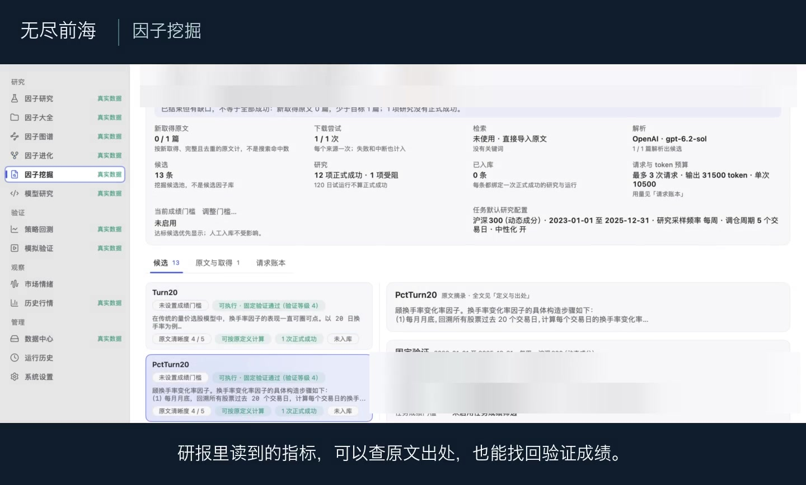

[▶ 观看因子挖掘：研报候选、原文与验证结果 · 总览节选](https://baiziyu2002git.github.io/ZiyuQuant/media/current/mining.mp4)

### 因子研究

单独检验一个因子：它给股票排出的顺序，和后面的收益有没有关系？

- 选因子、股票池、日期与评价频率，设置是否中性化，也可查看本次用的因子源码。结果区可以沿时间查看 IC、Rank IC，判断平均成绩是否只靠少数几天撑起来。
- 分层收益可以逐组比较；行业暴露和风格归因则用来追问，这个因子是不是总偏向某类股票。页面明确区分中性化前的行业暴露和按所选设置完成的回测。

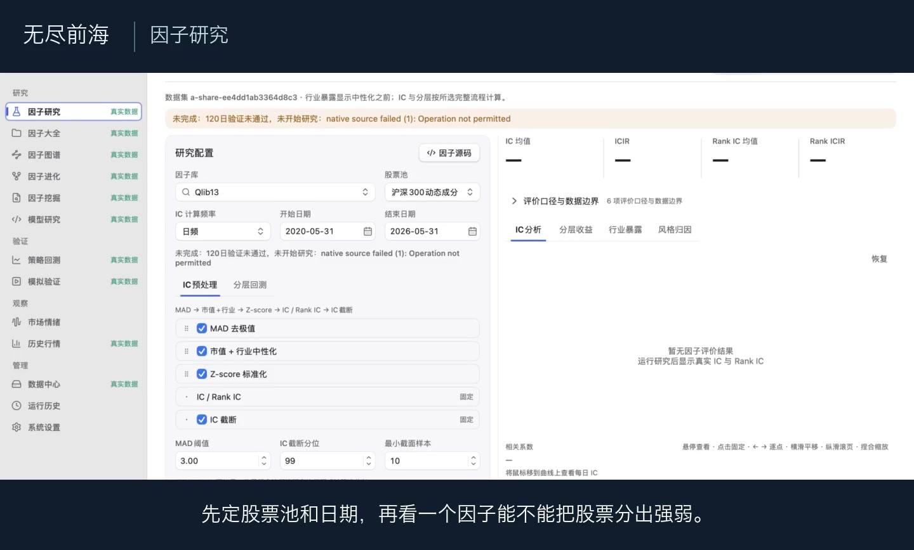

[▶ 观看因子研究：研究设置与结果区 · 总览节选](https://baiziyu2002git.github.io/ZiyuQuant/media/current/research.mp4)

### 因子大全

当问题从「这个因子怎样」变成「这一批里值得细看的有哪些」，就来这里。

- 可以搜因子名，按因子库、股票池、频率和状态筛选，查看匹配的历史成绩；日频不拿周频补，没测过的也不当作零。
- 选好一批后可以运行研究。结果区逐项列出成绩，并汇总本批完成数、失败数和平均指标；还可看横向比较、覆盖情况和任务日志，区分正式完成、仅验证通过和跳过。

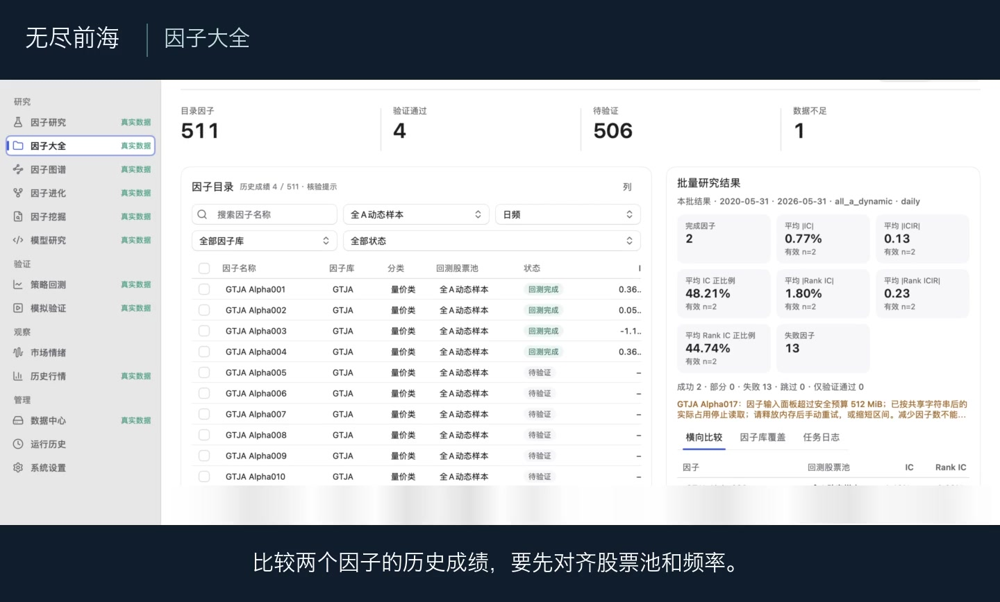

[▶ 观看因子大全：因子目录与批量成绩 · 总览节选](https://baiziyu2002git.github.io/ZiyuQuant/media/current/catalog.mp4)

### 因子进化

从已经研究过的原因子出发，保留原版，另建候选来试改动。

- 先看父因子的诊断，再选择生成方式。支持通过 API 生成，也可以导出任务、在外部完成后导回候选；每轮候选分别保留。
- 在同一批可比样本上对照父子成绩，查看变化、约束和相似度证据，再决定哪个值得保留。生成了候选和候选通过回测，是两件事。

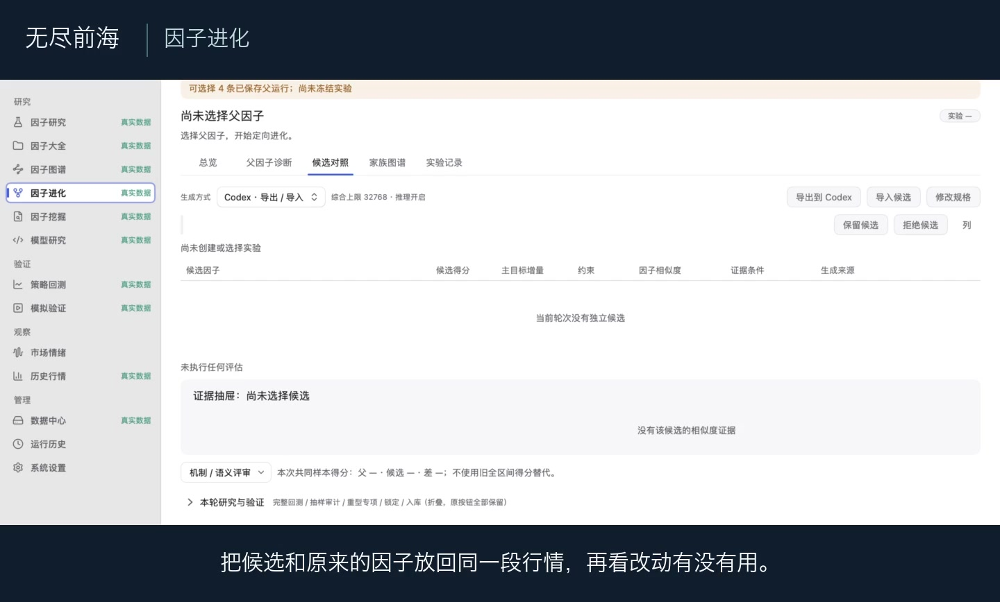

[▶ 观看因子进化：父因子与分轮候选对照 · 总览节选](https://baiziyu2002git.github.io/ZiyuQuant/media/current/evolution.mp4)

### 模型研究

用一组因子训练模型，重点看模型在没见过的行情上表现如何。

- 选择输入因子、股票池、预测目标和训练区间，再选模型并单独调它的参数。线性、树和神经网络模型可以共用实验条件；输入因子是否做行业与市值中性化也可选。
- 训练后查看样本外 IC、Rank IC 和预测覆盖；可对照已保存的运行，查看置换检验与正负因子贡献。满意的预测可交给策略回测，不用在策略页重训。

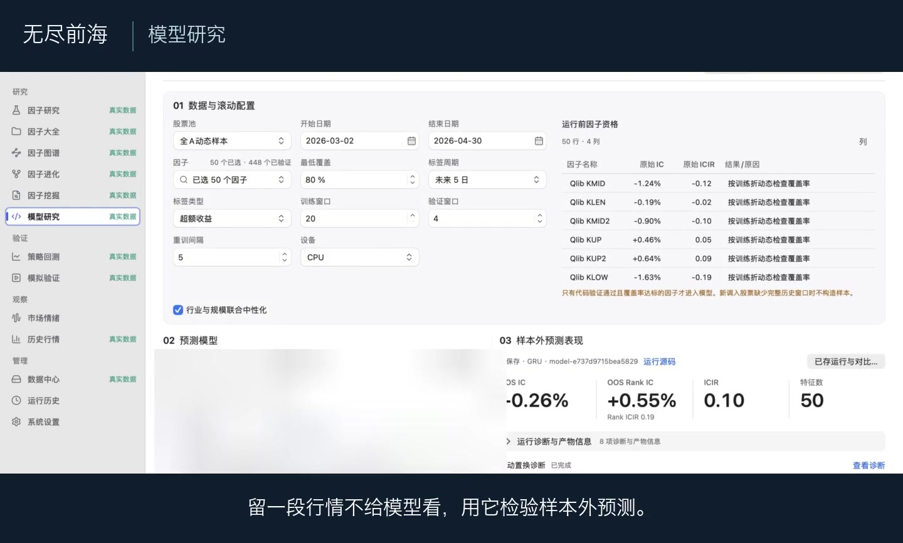

[▶ 观看模型研究：沿样本外双曲线查读数 · 操作专题](https://baiziyu2002git.github.io/ZiyuQuant/media/current/model.mp4)

### 策略回测

把预测或策略放进历史行情，关注的不只是哪天净值创新高，还有那笔单到底成交了没有。

- 可以接入模型研究已经保存的预测，查看策略净值、基准、相对收益、年化收益和最大回撤，并按时间区间观察曲线。
- 遇到曲线拐点，可对照历史持仓、委托和实际成交。下方片段展示的是尚未载入结果的页面，不是一次有收益的回测。

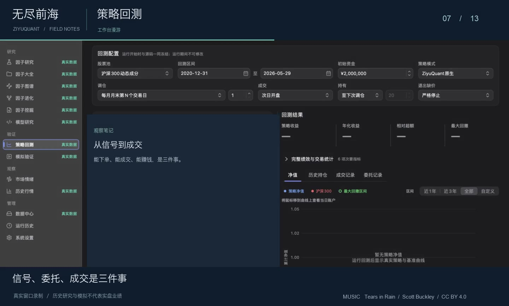

[▶ 观看策略回测：净值、持仓与订单入口 · 总览节选](https://baiziyu2002git.github.io/ZiyuQuant/media/current/backtest.mp4)

### 模拟验证

让策略在独立的模拟账本里逐日推进。它跟踪账户变化，不是真实券商交易。

- 可以切换模拟账户，查看净值、累计收益、超额收益和回撤，按近 20 日、近 40 日或自选区间与基准比较。
- 明日预单、委托和成交分别留账。可以翻历史持仓、对预单、查运行日志，分清是策略没发单、发单未成，还是已经成交。

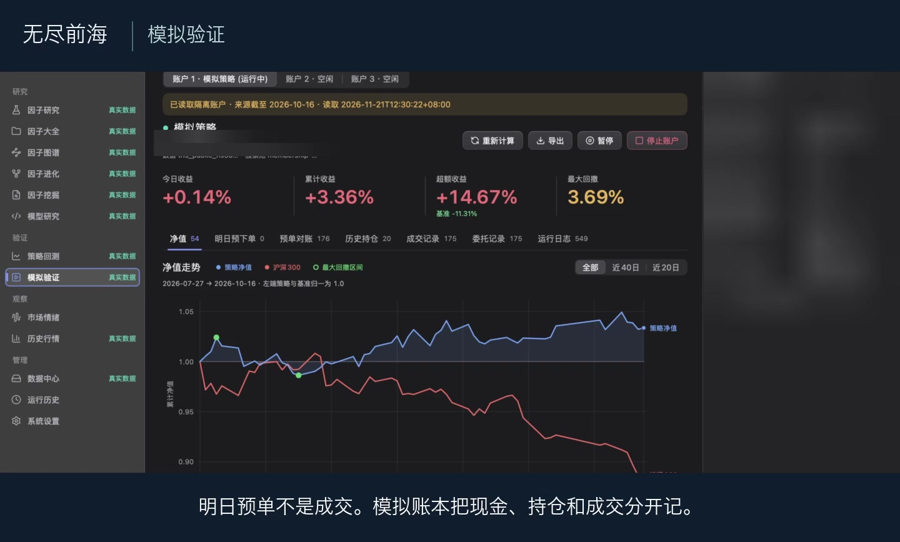

[▶ 观看模拟验证：切换区间、拖动时间轴与对照基准 · 操作专题](https://baiziyu2002git.github.io/ZiyuQuant/media/current/simulation.mp4)

### 市场情绪

想知道一个板块的升温是自己的行情，还是跟着大盘一起走，可以在这里对照。

- 按报告日期回看板块和大盘的情绪、趋势。支持切换近三月、半年、一年或全部，也可以拖动时间轴、在曲线上查看同一天的读数。
- 除了概览，还可以翻因子拆解、持仓与龙头、估值与财务，并查看数据来源和限制。看旧报告时，能分清报告日期和底层资料的截止日。

[▶ 观看市场情绪：三条曲线、时间窗口与悬停读数 · 操作专题](https://baiziyu2002git.github.io/ZiyuQuant/media/current/sentiment.mp4)

### 历史行情

查一只股票某天怎么走，也核对手头这份行情究竟更新到了哪天。

- 在日线上对照开高低收、成交量和均线，切换 MACD 等副图。用下方手柄放大选区，再拖动整个选区，就能比较相同长度的不同交易时段。
- 下载进度和行情展示分开：可以继续补下载、暂停或只处理一批。单只证券的最新日期与全池完整截止日分别显示，不能拿一只股票更新了当作全市场都齐了。

[▶ 观看历史行情：缩放和平移 K 线、切换副图 · 操作专题](https://baiziyu2002git.github.io/ZiyuQuant/media/current/historical-quotes.mp4)

### 数据中心

做研究前先查库存：本机有什么数据，哪张表能回答眼前的问题？

- 可以查日频行情、不同复权口径、资金流、行业历史和动态股票池等数据组件，了解各自的来源、格式、覆盖区间及使用模块。
- 用交易日数、股票数、记录数和安装状态核对覆盖。这里显示的是库存情况，不代表已将每条行情重新验算，也不等于下游任务已成功。

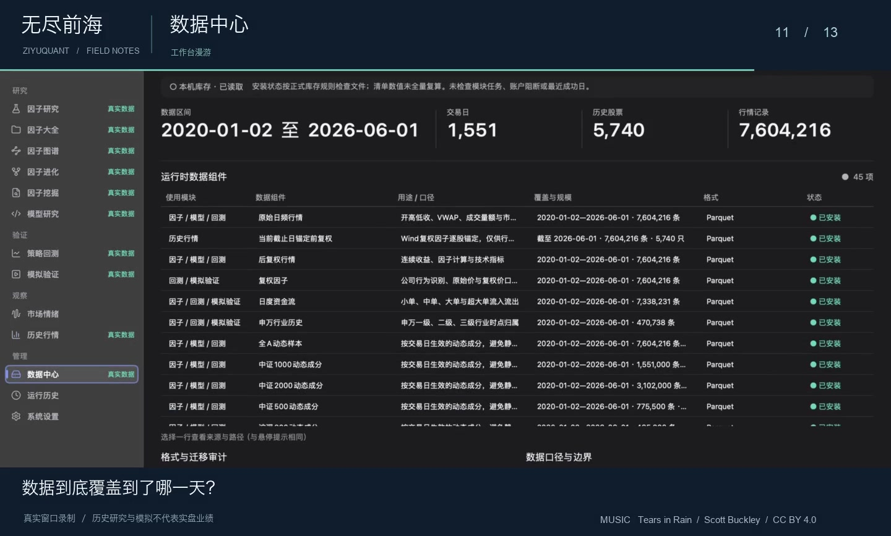

[▶ 观看数据中心：数据组件与覆盖范围 · 总览节选](https://baiziyu2002git.github.io/ZiyuQuant/media/current/data-center.mp4)

### 运行历史

找回上次跑的到底是哪一版研究，不用为看旧结果再算一遍。

- 按类型和状态找本地运行，查看运行 ID、研究区间和关键结果。有历史记录时，可打开该次运行的摘要、曲线和产物清单。
- 查看旧快照不会替换当前研究设置。片中当时没有可读取的记录，页面显示空列表和来源提示，而不是拿别的运行来填。

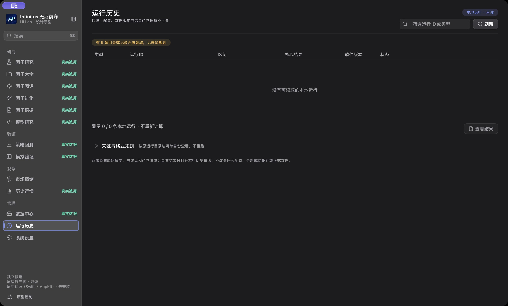

[▶ 观看运行历史：历史索引与结果入口 · 总览节选](https://baiziyu2002git.github.io/ZiyuQuant/media/current/history.mp4)

### 系统设置

把每天都要用的偏好集中在一处，也把会影响模拟结果的费用单独列清。

- 可选浅色、深色或跟随系统，调整开场与动效、减少动态效果；也可配置 App 打开期间的市场情绪更新偏好。
- 可分别设买卖佣金、最低佣金、滑点和印花税，并管理云端服务凭据。保存密钥本身不会发起生成请求。

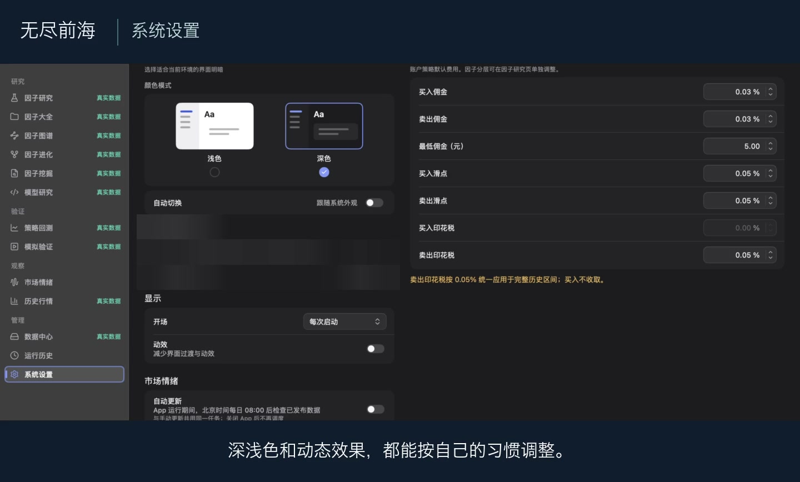

[▶ 观看系统设置：外观、动效与默认费用 · 总览节选](https://baiziyu2002git.github.io/ZiyuQuant/media/current/settings.mp4)

## 两个我自己踩过的坑

**同样叫周频，收益算到哪天？** 下一周第一个交易日，和今天往后数五个交易日，碰上长假就不再是同一天。下面保留原实验的数字。

信号期间为 **2023-01-01 → 2025-12-31**，实际包含 727 个交易日。股票池来自历史沪深300动态成分；沿用 300 个交易日预热，以及 MAD 3 倍阈值 → 市值／行业中性化 → Z-score。每个截面至少 10 个有效样本；两组分别对共同有效周序列做 1%／99% 线性分位缩尾后求均值。IC 不扣费用，也不在本项试验中运行分层、订单或账户回放。因子输入止于研究末日，之后的行情只用于完成收益标签。

三年共有 154 个周频信号日：130 个恰好相隔五个交易日，21 个只相隔一至四个交易日，另有 3 个因下一自然周整周休市而没有现行周标签。主表只比较共同有效的 **151 周、45,298 个股票—周记录**，每一周两组使用相同股票；不把五日组额外可评的 900 条记录混进均值对比。

IC／Rank IC 以百分数展示；差值为“五日累乘 − 现行周频”，单位为百分点，按未舍入均值计算。

| 因子 | 现行周频 IC | 五日累乘 IC | ΔIC（百分点） | 现行周频 Rank IC | 五日累乘 Rank IC | ΔRank IC（百分点） |
| --- | ---: | ---: | ---: | ---: | ---: | ---: |
| KMID | 0.46% | -0.27% | -0.7315 | -0.35% | -0.82% | -0.4607 |
| KLEN | -0.70% | -1.17% | -0.4757 | -2.73% | -2.93% | -0.1961 |
| KLOW | -0.92% | -1.17% | -0.2445 | -2.04% | -2.24% | -0.1954 |
| VWAP0 | 0.77% | 1.38% | +0.6113 | 0.96% | 1.56% | +0.6007 |
| ROC5 | -0.75% | -0.02% | +0.7340 | 0.04% | 0.65% | +0.6116 |
| ROC20 | -0.72% | 0.07% | +0.7933 | 0.20% | 0.83% | +0.6303 |
| MA5 | -1.08% | -0.35% | +0.7245 | -0.38% | 0.14% | +0.5213 |
| MA20 | -0.79% | -0.03% | +0.7628 | 0.16% | 0.76% | +0.5976 |
| STD5 | -0.10% | -0.62% | -0.5200 | -2.30% | -2.66% | -0.3625 |
| STD20 | -0.32% | -0.50% | -0.1804 | -2.49% | -2.52% | -0.0314 |

**差异主要来自节假日前后的收益终点，而不是累乘本身。** 例如 2024-09-30 的现行周标签到 2024-10-08，实际只有一个交易日间隔；固定五日组则到 2024-10-14。在主表十因子中，IC 均值变化最大为 ROC20 的 +0.7933 个百分点，Rank IC 均值变化最大为 +0.6303 个百分点；不能据此宣称预测能力改善。

展开：相同五日端点控制、浮点并列排名与来源身份

为分清“区间变了”和“算法变了”，再将两组都固定为同一个五日端点。154 周的共同有效记录为 46,198 条；两组均保留另外 2 条缺价记录为空，未补零。此时：

- 逐股收益最大绝对差为 **6.66 × 10⁻¹⁶**；预先约定的核对范围为绝对误差 `1e-12` ＋ 相对误差 `1e-12`，没有超出。
- 十因子未缩尾单周 IC 的最大绝对差为 **8.40 × 10⁻¹⁶**，属于浮点尾数；现行周标签与独立端点连接复算则逐值、连同缺失掩码完全一致。
- **Rank IC 不能直接声称逐值一致。** 累乘的浮点尾数会把本来并列的收益拆开；不先舍入收益时，同五日端点的十因子 Rank IC 均值差仍可达 **0.001579 个百分点**，单周最大差为 **0.068162 个百分点**。这不是新的预测信息。

下表仍按原设置缩尾，不做收益舍入或强行合并排名。两位小数可能看不出小差，因此另列六位小数的 Rank IC 均值差；这里的样本范围与上面的 151 周主表不同，不能跨表直接作提升结论。

| 因子 | 五日端点 IC | 五日累乘 IC | 五日端点 Rank IC | 五日累乘 Rank IC | ΔRank IC（百分点） |
| --- | ---: | ---: | ---: | ---: | ---: |
| KMID | -0.39% | -0.39% | -0.96% | -0.96% | -0.000762 |
| KLEN | -0.97% | -0.97% | -2.77% | -2.77% | -0.000249 |
| KLOW | -1.23% | -1.23% | -2.27% | -2.27% | +0.000549 |
| VWAP0 | 1.57% | 1.57% | 1.72% | 1.72% | +0.000703 |
| ROC5 | 0.16% | 0.16% | 0.86% | 0.86% | -0.000161 |
| ROC20 | 0.17% | 0.17% | 1.02% | 1.02% | -0.000204 |
| MA5 | -0.22% | -0.22% | 0.34% | 0.34% | -0.000180 |
| MA20 | 0.11% | 0.11% | 0.95% | 0.95% | -0.000427 |
| STD5 | -0.31% | -0.31% | -2.37% | -2.38% | -0.001579 |
| STD20 | -0.37% | -0.37% | -2.34% | -2.34% | -0.000179 |

对最大单周差案例 STD20（2025-06-03）另用中心化内积、SciPy 平均秩和高精度十进制进行复核，相关计算一致。在完整同五日样本中，共有 354 条股票—周收益排名发生变化，全部属于端点收益的并列组；仅在诊断中恢复这些并列关系后，排名差归零。**这一诊断没有改写原框架，也没有参与以上两表取数。** 将累乘窗口改为与现行自然周完全相同后，45,298 条共同收益的最大差同样只有 6.66 × 10⁻¹⁶。

三处“下一自然周无交易日”的信号为 2023-01-16、2023-09-25、2024-02-05；两处两组均缺价的信号为 600837.SH 的 2025-03-03、601989.SH 的 2025-09-01。本轮如实保留这些边界，没有修改标签规则或证券历史。

**能选到，不代表买得到。** 这次还做了一个只改涨跌停成交条件的对照：2023 年至 2025 年、沪深300动态、10 个预先选定的 Qlib 因子、5 层、每 5 个交易日调仓。信号、预处理、费用、次日收盘执行和事件处理全部一致，只比较涨停能不能买、跌停能不能卖。

Q1 是最高因子值组。下面是三年**累计净收益**，不是年化，也没有按收益挑选方向：

| 因子 | 忽略限价阻挡 | 启用限价阻挡 | 差值（百分点） |
| --- | ---: | ---: | ---: |
| KMID | 21.06% | 18.42% | -2.63 |
| KLEN | 8.10% | 5.92% | -2.18 |
| KLOW | 36.93% | 34.68% | -2.26 |
| VWAP0 | 12.83% | 10.82% | -2.01 |
| ROC5 | 10.33% | 9.85% | -0.48 |
| ROC20 | 16.18% | 15.67% | -0.51 |
| MA5 | 10.00% | 9.18% | -0.81 |
| MA20 | 22.41% | 21.74% | -0.67 |
| STD5 | 34.62% | 31.91% | -2.72 |
| STD20 | 43.15% | 40.95% | -2.20 |

五层合计的 50 个差异中，43 个为负、7 个为正；差异从 −4.78 到 +0.68 个百分点。过滤不是保证某一层收益必然变差，而是让不该成交的单别假装成交。小小一个开关，账已经不是原来那本账。

这些都是历史研究或模拟，不是实盘业绩，也不是收益承诺。[实验方法与限制](docs/research-notes.md) · [完整历史实验记录](docs/周频与涨跌停实验.md) · [独立回测框架](backtest-framework/README.md)

配乐：[《Tears in Rain》](https://www.scottbuckley.com.au/library/tears-in-rain/) · Scott Buckley，[CC BY 4.0](https://creativecommons.org/licenses/by/4.0/)。各片选取不同片段，调整了音量并作淡入淡出；视频字幕以黑底白字叠在窗口内，截图不带字幕，无配音。
