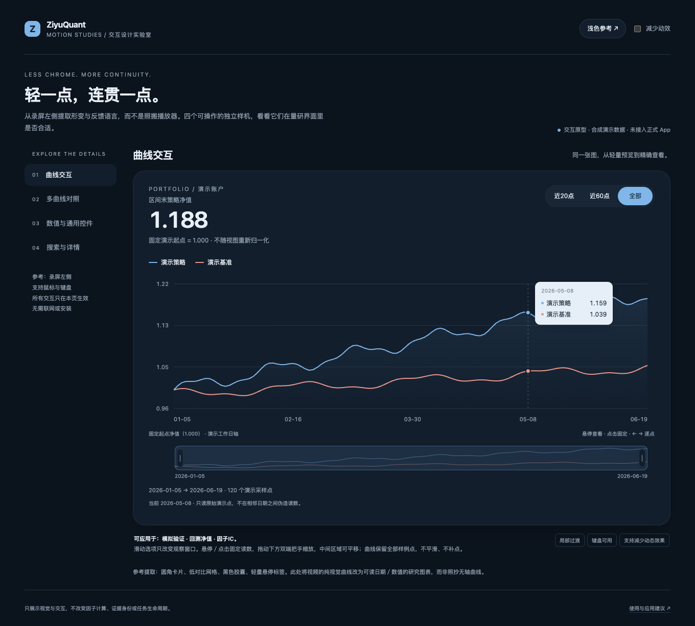
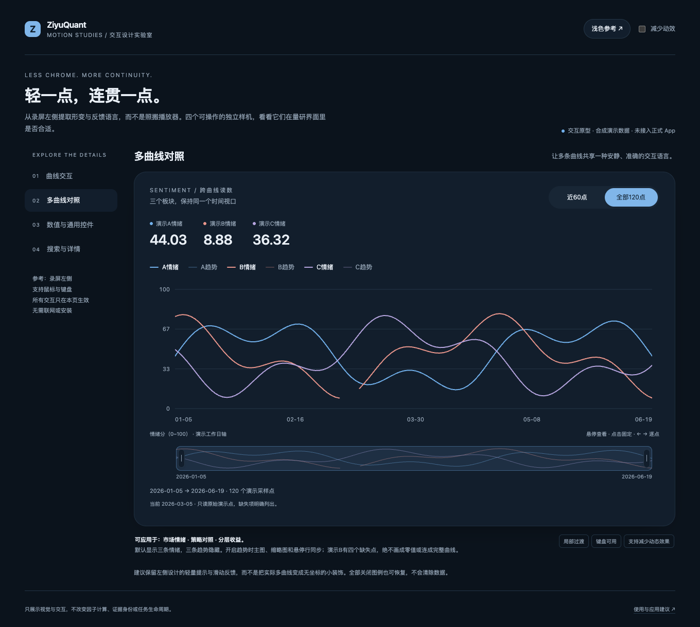
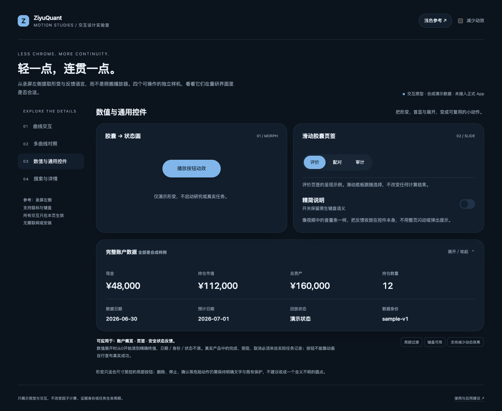
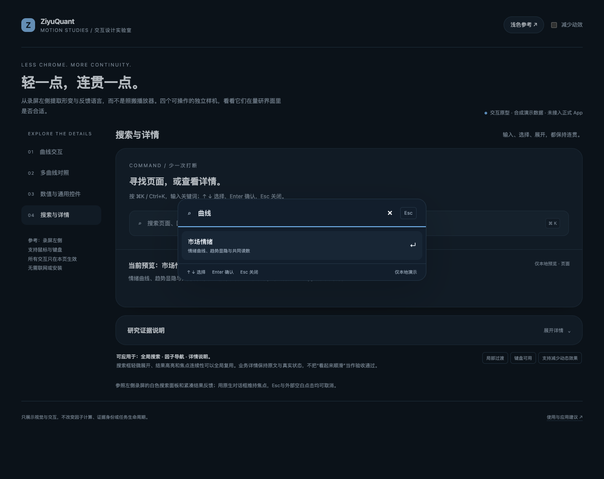

# 交互设计预览 · 2026-10-18

这一组是独立设计样机的实际渲染截图，使用合成数据，**不是正式 App 截图，也不是研究结果**。本仓库只发布图片，不上传样机的HTML、CSS或JavaScript。

想试的方向很简单：少一点重边框，多一点连续感。该精确读数的时候别晃，该取消的时候能立即取消。不是所有地方都得动，更不能拿动画把“尚未计算”演成“已经成功”。

## 曲线：轻预览和精确查看在一张图里

这个样机试了区间胶囊、邻近采样点悬停、点击固定、键盘逐点查看，以及双端时间窗缩放和平移。截图里的120个点是演示采样点，不是有效A股交易日历；净值不是回测绩效。

它还刻意采用了固定演示起点，不随观察窗口重新归一化。这是样机自己的展示语义，不能拿来描述正式 App：正式模拟净值图仍有按所选区间左端重新归一的原口径。

## 多曲线：不想看的隐藏，缺了的就断开

顶部数值、图例、主图、缩略图共享显隐选择。情绪默认显示，趋势按需开启；图中B曲线故意放了一段缺失，主图和缩略图都不连过去。缺失不是0，也不拿前一天的值补成“连续”。

## 数值和控件：动的是显示，不是结果

账户展开时，金额和数量从0走到固定样例终值；日期、版本、文字状态不滚。减少动态效果时直接显示终值。

左上按钮的胶囊／圆形形变只是一个可取消的视觉实验，不是正式任务的完成信号。产品里的成功、失败、取消仍必须由真实任务记录决定，不照搬样机定时器。

## 搜索：少打断一次也挺好

试的是输入、过滤、键盘选择和Esc归还焦点的连贯感。它只在样机内部选择页面，不会进入正式 App，更不会顺手启动研究。

正式 App 已有的数值展开、市场情绪默认显隐、净值导航和页面浏览呈现，与这些新增设计实验分开说明。样机展示了方向，不是“所有效果已上线”的凭证，也不拿浏览器窄窗／2×检查替代原生硬件验证。

素材取自2026-10-18独立样机的最终渲染输出。未发布参考录屏、个人账户收益图、研究数据或本地路径清单。

[返回展示首页](../README.md)
